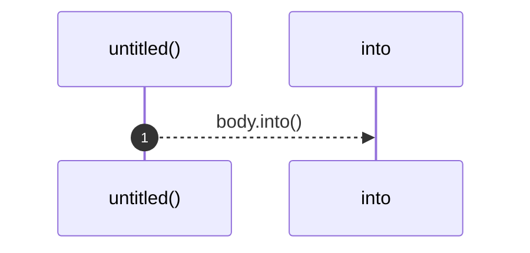
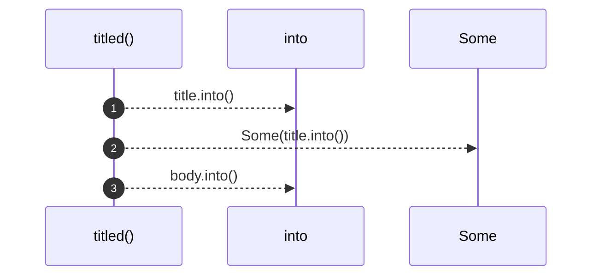
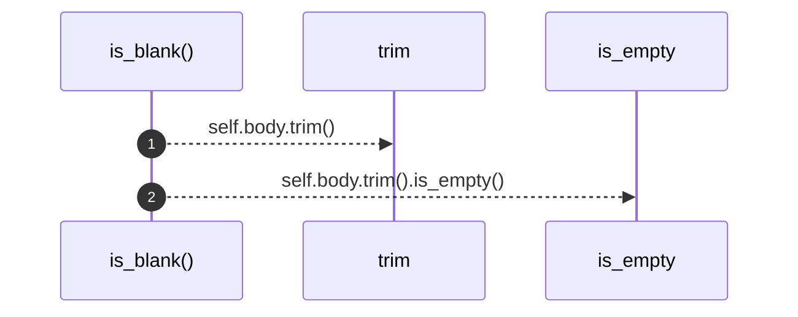

# `robby_render::report::impl Section`

[Self-model](../../README.md) · [report](index.md)

| | |
|---|---|
| kind | `code.impl` |
| location | [`crates/robby-render/src/report.rs:16`](../../../../crates/robby-render/src/report.rs#L16) |
| provenance | extractor · confidence 1.00 |

```rust
impl Section {
    pub fn untitled(body: impl Into<String>) -> Self {
        Self {
            title: None,
            body: body.into(),
        }
    }

    pub fn titled(title: impl Into<String>, body: impl Into<String>) -> Self {
        Self {
            title: Some(title.into()),
            body: body.into(),
        }
    }

    pub fn is_blank(&self) -> bool {
        self.body.trim().is_empty()
    }
}
```

## References

- calls → [`robby_render::view::links`](../view/links/index.md) — is_empty

## Referenced by

- calls ← [`robby_render::report::impl Report::push`](index.md)
- calls ← [`robby_render::report::impl Report::push_body`](index.md)
- calls ← [`robby_render::report::impl Report::push_titled`](index.md)

### `untitled`

| | |
|---|---|
| kind | `code.method` |
| signature | `fn untitled(1)` |
| location | [`crates/robby-render/src/report.rs:17`](../../../../crates/robby-render/src/report.rs#L17) |
| provenance | extractor · confidence 1.00 |

```rust
pub fn untitled(body: impl Into<String>) -> Self {
        Self {
            title: None,
            body: body.into(),
        }
    }
```



1 steps · 0 observed · 1 possible only

### `titled`

| | |
|---|---|
| kind | `code.method` |
| signature | `fn titled(2)` |
| location | [`crates/robby-render/src/report.rs:24`](../../../../crates/robby-render/src/report.rs#L24) |
| provenance | extractor · confidence 1.00 |

```rust
pub fn titled(title: impl Into<String>, body: impl Into<String>) -> Self {
        Self {
            title: Some(title.into()),
            body: body.into(),
        }
    }
```



3 steps · 0 observed · 3 possible only

### `is_blank`

| | |
|---|---|
| kind | `code.method` |
| signature | `fn is_blank(1)` |
| location | [`crates/robby-render/src/report.rs:31`](../../../../crates/robby-render/src/report.rs#L31) |
| provenance | extractor · confidence 1.00 |

```rust
pub fn is_blank(&self) -> bool {
        self.body.trim().is_empty()
    }
```



2 steps · 0 observed · 2 possible only

**Edges**

- calls → [`robby_render::view::links::impl LinkGraph::is_empty`](../view/links/index.md)

