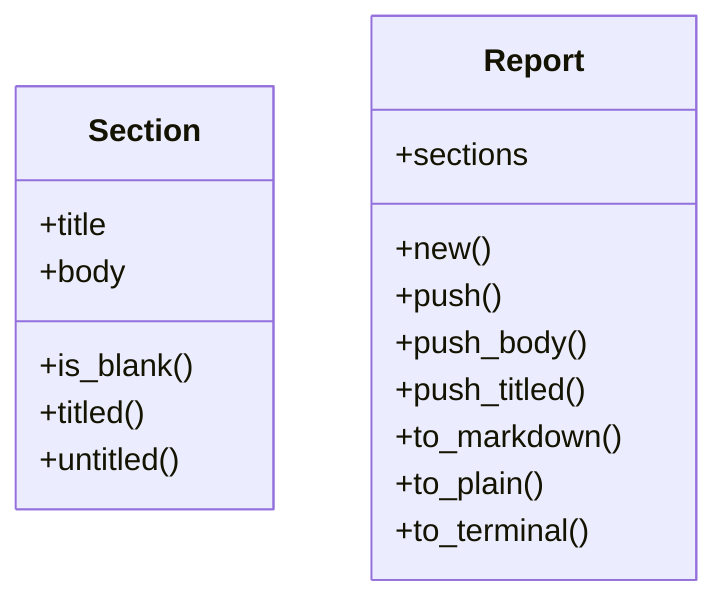
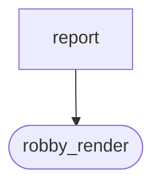
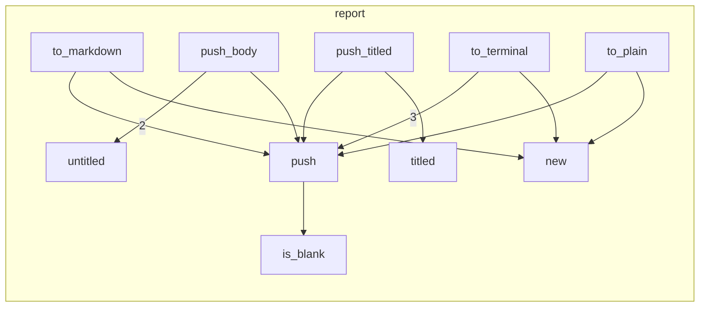

# `robby_render::report`

[Self-model](../../README.md) · [robby_render](../index.md)

| | |
|---|---|
| kind | `code.module` |
| declared at | [`crates/robby-render/src/lib.rs:13`](../../../../crates/robby-render/src/lib.rs#L13) |
| provenance | extractor · confidence 1.00 |
| nodes | 19 |

## Types



## Package diagram



## Module coupling



## Dependency matrix

| | report | robby_render |
|---|---:|---:|
| **report** | · | 4 |
| **robby_render** | | · |

## Comments

- `crates/robby-render/src/report.rs:104:5` (docs, `robby_render::report::impl Report::to_plain`): "Raw concatenation (e.g. a single `.mmd` diagram body)."
  ```
  /// Raw concatenation (e.g. a single `.mmd` diagram body).
      pub fn to_plain(&self) -> String {
          let mut out = String::new();
          for section in &self.sections {
              out.push_str(&section.body);
              if !section.body.ends_with('\n') {
                  out.push('\n');
              }
          }
          out
      }
  ```
- `crates/robby-render/src/report.rs:36:1` (docs, `robby_render::report::Report`): "Static artifact built from rendered views."
  ```
  /// Static artifact built from rendered views.
  #[derive(Debug, Clone, PartialEq, Eq, Default)]
  pub struct Report {
      pub sections: Vec<Section>,
  }
  ```
- `crates/robby-render/src/report.rs:61:5` (docs, `robby_render::report::impl Report::to_markdown`): "Markdown artifact: optional `##` headings, bodies as-is (callers fence diagrams)."
  ```
  /// Markdown artifact: optional `##` headings, bodies as-is (callers fence diagrams).
      pub fn to_markdown(&self) -> String {
          let mut out = String::new();
          for (index, section) in self.sections.iter().enumerate() {
              if index > 0 && !out.ends_with("\n\n") {
                  if out.ends_with('\n') {
                      out.push('\n');
                  } else {
                      out.push_str("\n\n");
                  }
              }
              if let Some(title) = &section.title {
                  let _ = writeln!(out, "## {title}\n");
              }
              out.push_str(&section.body);
              if !section.body.ends_with('\n') {
                  out.push('\n');
              }
          }
          out
      }
  ```
- `crates/robby-render/src/report.rs:83:5` (docs, `robby_render::report::impl Report::to_terminal`): "Terminal artifact: rule-separated titled sections."
  ```
  /// Terminal artifact: rule-separated titled sections.
      pub fn to_terminal(&self, width: usize) -> String {
          let rule = "─".repeat(width.clamp(24, 78));
          let mut out = String::new();
          for section in &self.sections {
              if let Some(title) = &section.title {
                  if !out.is_empty() {
                      out.push('\n');
                  }
                  let _ = writeln!(out, "{title}\n{rule}");
              } else if !out.is_empty() && !out.ends_with('\n') {
                  out.push('\n');
              }
              out.push_str(&section.body);
              if !section.body.ends_with('\n') {
                  out.push('\n');
              }
          }
          out
      }
  ```
- `crates/robby-render/src/report.rs:9:1` (docs, `robby_render::report::Section`): "One titled block inside a report."
  ```
  /// One titled block inside a report.
  #[derive(Debug, Clone, PartialEq, Eq)]
  pub struct Section {
      pub title: Option<String>,
      pub body: String,
  }
  ```
## References

- calls → [`robby_render::render::tui`](../render/tui/index.md) — default
- calls → [`robby_render::view::links`](../view/links/index.md) — is_empty

## Referenced by

- calls ← [`robby_agent::context::collect_comment_contexts`](../../robby_agent/context/collect-comment-contexts.md)
- calls ← [`robby_agent::context::line_window`](../../robby_agent/context/line-window.md)
- calls ← [`robby_cli::workspace`](../../robby_cli/workspace.md)
- calls ← [`robby_extract::rust::collect_rs`](../../robby_extract/rust/collect-rs.md)
- calls ← [`robby_extract::rust::discover_crates`](../../robby_extract/rust/discover-crates.md)
- calls ← [`robby_extract::rust::docs_of`](../../robby_extract/rust/docs-of.md)
- calls ← [`robby_extract::rust::impl LineIndex::new`](../../robby_extract/rust/index.md)
- calls ← [`robby_extract::rust::impl ProcBuilder<'_, '_>::push_block`](../../robby_extract/rust/index.md)
- calls ← [`robby_extract::rust::path_text`](../../robby_extract/rust/path-text.md)
- calls ← [`robby_extract::rust::resolve_calls`](../../robby_extract/rust/resolve-calls.md)
- calls ← [`robby_extract::rust::rust_files`](../../robby_extract/rust/rust-files.md)
- calls ← [`robby_extract::rust::sanitize`](../../robby_extract/rust/sanitize.md)
- calls ← [`robby_extract::rust::walk_expr`](../../robby_extract/rust/walk-expr.md)
- calls ← [`robby_extract::typescript::collect_ts`](../../robby_extract/typescript/collect-ts.md)
- calls ← [`robby_extract::typescript::discover_packages`](../../robby_extract/typescript/discover-packages.md)
- calls ← [`robby_extract::typescript::emit_class`](../../robby_extract/typescript/emit-class.md)
- calls ← [`robby_extract::typescript::emit_import`](../../robby_extract/typescript/emit-import.md)
- calls ← [`robby_extract::typescript::emit_interface`](../../robby_extract/typescript/emit-interface.md)
- calls ← [`robby_extract::typescript::resolve_calls`](../../robby_extract/typescript/resolve-calls.md)
- calls ← [`robby_extract::typescript::resolve_relative_import`](../../robby_extract/typescript/resolve-relative-import.md)
- calls ← [`robby_extract::typescript::sanitize`](../../robby_extract/typescript/sanitize.md)
- calls ← [`robby_extract::typescript::walk_expr`](../../robby_extract/typescript/walk-expr.md)
- calls ← [`robby_extract::typescript::walk_stmts`](../../robby_extract/typescript/walk-stmts.md)
- calls ← [`robby_ir::codepath::impl CodePath::from_entry`](../../robby_ir/codepath/index.md)
- calls ← [`robby_ir::codepath::sample_doc`](../../robby_ir/codepath/tests/sample-doc.md)
- calls ← [`robby_ir::coverage::all_spans`](../../robby_ir/coverage/all-spans.md)
- calls ← [`robby_ir::coverage::document_coverage`](../../robby_ir/coverage/document-coverage.md)
- calls ← [`robby_ir::coverage::file_coverage`](../../robby_ir/coverage/file-coverage.md)
- calls ← [`robby_ir::coverage::frontier_spans`](../../robby_ir/coverage/frontier-spans.md)
- calls ← [`robby_ir::model::impl Document::declare_file`](../../robby_ir/model/index.md)
- calls ← [`robby_ir::model::impl Document::merge`](../../robby_ir/model/index.md)
- calls ← [`robby_ir::model::impl Document::record_child`](../../robby_ir/model/index.md)
- calls ← [`robby_ir::model::impl Document::walk`](../../robby_ir/model/index.md)
- calls ← [`robby_ir::model::validate`](../../robby_ir/model/validate.md)
- calls ← [`robby_ir::process::impl Process::absorb`](../../robby_ir/process/index.md)
- calls ← [`robby_ir::process::impl Process::participant`](../../robby_ir/process/index.md)
- calls ← [`robby_ir::process::impl Process::step`](../../robby_ir/process/index.md)
- calls ← [`robby_render::dependency_report`](../dependency-report.md)
- calls ← [`robby_render::markdown::coverage_section`](../markdown/coverage-section.md)
- calls ← [`robby_render::markdown::node_section`](../markdown/node-section.md)
- calls ← [`robby_render::markdown::report`](../markdown/report.md)
- calls ← [`robby_render::pipeline::load_sources`](../pipeline/load-sources.md)
- calls ← [`robby_render::pipeline::slug`](../pipeline/slug.md)
- calls ← [`robby_render::render::markdown::impl MarkdownRenderer::fence`](../render/markdown/index.md)
- calls ← [`robby_render::render::markdown::impl Renderer for MarkdownRenderer::comments`](../render/markdown/index.md)
- calls ← [`robby_render::render::markdown::impl Renderer for MarkdownRenderer::links`](../render/markdown/index.md)
- calls ← [`robby_render::render::markdown::impl Renderer for MarkdownRenderer::meta`](../render/markdown/index.md)
- calls ← [`robby_render::render::mermaid::dsm_markdown_table`](../render/mermaid/dsm-markdown-table.md)
- calls ← [`robby_render::render::mermaid::impl Renderer for MermaidRenderer::coupling_deps`](../render/mermaid/index.md)
- calls ← [`robby_render::render::tui::ascii_coupling`](../render/tui/ascii-coupling.md)
- calls ← [`robby_render::render::tui::clip`](../render/tui/clip.md)
- calls ← [`robby_render::render::tui::impl Renderer for TuiRenderer::comments`](../render/tui/index.md)
- calls ← [`robby_render::render::tui::impl Renderer for TuiRenderer::links`](../render/tui/index.md)
- calls ← [`robby_render::render::tui::impl Renderer for TuiRenderer::meta`](../render/tui/index.md)
- calls ← [`robby_render::render::tui::impl Renderer for TuiRenderer::process`](../render/tui/index.md)
- calls ← [`robby_render::render::tui::impl Renderer for TuiRenderer::sibling_graph`](../render/tui/index.md)
- calls ← [`robby_render::render::tui::impl Renderer for TuiRenderer::source`](../render/tui/index.md)
- calls ← [`robby_render::render::tui::impl Renderer for TuiRenderer::types`](../render/tui/index.md)
- calls ← [`robby_render::render::tui::impl TuiRenderer::render_report`](../render/tui/index.md)
- calls ← [`robby_render::test_markdown::fixture`](../test_markdown/fixture.md)
- calls ← [`robby_render::test_render::class_diagram_marks_traits_as_interfaces`](../test_render/class-diagram-marks-traits-as-interfaces.md)
- calls ← [`robby_render::test_render::dependencies_emits_package_weighted_and_dsm`](../test_render/dependencies-emits-package-weighted-and-dsm.md)
- calls ← [`robby_render::test_render::externals_and_comments_sections_render`](../test_render/externals-and-comments-sections-render.md)
- calls ← [`robby_render::test_render::flowchart_clusters_modules`](../test_render/flowchart-clusters-modules.md)
- calls ← [`robby_render::test_render::process`](../test_render/process.md)
- calls ← [`robby_render::test_tree::every_internal_link_resolves`](../test_tree/every-internal-link-resolves.md)
- calls ← [`robby_render::test_tree::markdown_links`](../test_tree/markdown-links.md)
- calls ← [`robby_render::test_tree::normalize`](../test_tree/normalize.md)
- calls ← [`robby_render::test_tree::page_names_never_collide_with_index`](../test_tree/page-names-never-collide-with-index.md)
- calls ← [`robby_render::test_web::demo_doc`](../test_web/demo-doc.md)
- calls ← [`robby_render::test_web::entrypoints_demo_doc`](../test_web/entrypoints-demo-doc.md)
- calls ← [`robby_render::test_web::frame_detail_includes_execution_mermaid_for_call_path`](../test_web/frame-detail-includes-execution-mermaid-for-call-path.md)
- calls ← [`robby_render::tree::global_index`](../tree/global-index.md)
- calls ← [`robby_render::tree::item_page`](../tree/item-page.md)
- calls ← [`robby_render::tree::item_slug`](../tree/item-slug.md)
- calls ← [`robby_render::tree::item_slugs`](../tree/item-slugs.md)
- calls ← [`robby_render::tree::module_page`](../tree/module-page.md)
- calls ← [`robby_render::tree::module_pages`](../tree/module-pages.md)
- calls ← [`robby_render::tree::nav`](../tree/nav.md)
- calls ← [`robby_render::tree::page_of_node`](../tree/page-of-node.md)
- calls ← [`robby_render::tree::rel_link`](../tree/rel-link.md)
- calls ← [`robby_render::tree::render_links`](../tree/render-links.md)
- calls ← [`robby_render::tree::render_node`](../tree/render-node.md)
- calls ← [`robby_render::tree::resolve_use_path`](../tree/resolve-use-path.md)
- calls ← [`robby_render::tree::tree`](../tree/tree.md)
- calls ← [`robby_render::tui::graph`](../tui/graph.md)
- calls ← [`robby_render::tui::show`](../tui/show.md)
- calls ← [`robby_render::tui::show_collected`](../tui/show-collected.md)
- calls ← [`robby_render::tui::tree`](../tui/tree.md)
- calls ← [`robby_render::util::alias`](../util/alias.md)
- calls ← [`robby_render::util::text`](../util/text.md)
- calls ← [`robby_render::view::comments::apply_highlights`](../view/comments/apply-highlights.md)
- calls ← [`robby_render::view::comments::impl CommentsView::from_root`](../view/comments/index.md)
- calls ← [`robby_render::view::comments::line_window`](../view/comments/line-window.md)
- calls ← [`robby_render::view::deps::impl CouplingGraph::workspace`](../view/deps/index.md)
- calls ← [`robby_render::view::deps::topological_layers`](../view/deps/topological-layers.md)
- calls ← [`robby_render::view::entrypoints::collect_cross_edges`](../view/entrypoints/collect-cross-edges.md)
- calls ← [`robby_render::view::entrypoints::doc_with_mains`](../view/entrypoints/tests/doc-with-mains.md)
- calls ← [`robby_render::view::entrypoints::impl CallTree::from_code_paths`](../view/entrypoints/index.md)
- calls ← [`robby_render::view::execution::sample`](../view/execution/tests/sample.md)
- calls ← [`robby_render::view::hierarchy::build`](../view/hierarchy/build.md)
- calls ← [`robby_render::view::process::impl ProcessView::from_process`](../view/process/index.md)
- calls ← [`robby_render::view::scene::attach_call_portals`](../view/scene/attach-call-portals.md)
- calls ← [`robby_render::view::scene::build_call_frame`](../view/scene/build-call-frame.md)
- calls ← [`robby_render::view::scene::build_frame`](../view/scene/build-frame.md)
- calls ← [`robby_render::view::scene::impl Scene::from_document`](../view/scene/index.md)
- calls ← [`robby_render::view::scene::impl Scene::from_entrypoints`](../view/scene/index.md)
- calls ← [`robby_render::view::scene::layout_grid`](../view/scene/layout-grid.md)
- calls ← [`robby_render::view::scene::portals_for`](../view/scene/portals-for.md)
- calls ← [`robby_render::view::sibling::impl SiblingGraph::from_root`](../view/sibling/index.md)
- calls ← [`robby_render::view::types::class_from_node`](../view/types/class-from-node.md)
- calls ← [`robby_render::view::types::impl TypeModel::from_module`](../view/types/index.md)
- calls ← [`robby_render::web::write_site`](../web/write-site.md)
- calls ← [`robby_render::workspace_dependencies`](../workspace-dependencies.md)

## Items

| Item | Kind | Steps | Location |
|---|---|---:|---|
| [`Section`](section.md) | `code.struct` | — | `crates/robby-render/src/report.rs:9:1` |
| [`impl Section`](impl-section.md) | `code.impl` | — | `crates/robby-render/src/report.rs:16:1` |
| [`Report`](report.md) | `code.struct` | — | `crates/robby-render/src/report.rs:36:1` |
| [`impl Report`](impl-report.md) | `code.impl` | — | `crates/robby-render/src/report.rs:42:1` |

## Imports

- `use std::fmt::Write as _;`

