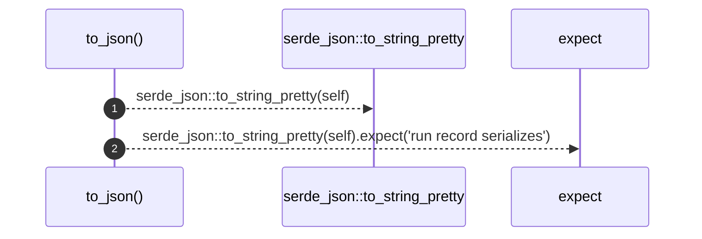
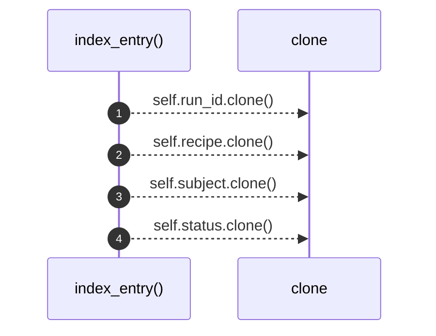

# `robby_render::runs::impl RunRecord`

[Self-model](../../README.md) · [runs](index.md)

| | |
|---|---|
| kind | `code.impl` |
| location | [`crates/robby-render/src/runs.rs:90`](../../../../crates/robby-render/src/runs.rs#L90) |
| provenance | extractor · confidence 1.00 |

```rust
impl RunRecord {
    pub fn to_json(&self) -> String {
        serde_json::to_string_pretty(self).expect("run record serializes")
    }

    pub fn index_entry(&self) -> RunIndexEntry {
        RunIndexEntry {
            run_id: self.run_id.clone(),
            recipe: self.recipe.clone(),
            subject: self.subject.clone(),
            status: self.status.clone(),
            started_at: self.started_at,
            finished_at: self.finished_at,
        }
    }
}
```

## Referenced by

- calls ← [`robby_render::runs::write_runs`](write-runs.md)
- calls ← [`robby_render::test_web::entrypoints_scene_json_is_deterministic`](../test_web/entrypoints-scene-json-is-deterministic.md)
- calls ← [`robby_render::test_web::scene_json_is_byte_identical_across_runs`](../test_web/scene-json-is-byte-identical-across-runs.md)

### `to_json`

| | |
|---|---|
| kind | `code.method` |
| signature | `fn to_json(1)` |
| location | [`crates/robby-render/src/runs.rs:91`](../../../../crates/robby-render/src/runs.rs#L91) |
| provenance | extractor · confidence 1.00 |

```rust
pub fn to_json(&self) -> String {
        serde_json::to_string_pretty(self).expect("run record serializes")
    }
```



2 steps · 0 observed · 2 possible only

### `index_entry`

| | |
|---|---|
| kind | `code.method` |
| signature | `fn index_entry(1)` |
| location | [`crates/robby-render/src/runs.rs:95`](../../../../crates/robby-render/src/runs.rs#L95) |
| provenance | extractor · confidence 1.00 |

```rust
pub fn index_entry(&self) -> RunIndexEntry {
        RunIndexEntry {
            run_id: self.run_id.clone(),
            recipe: self.recipe.clone(),
            subject: self.subject.clone(),
            status: self.status.clone(),
            started_at: self.started_at,
            finished_at: self.finished_at,
        }
    }
```



4 steps · 0 observed · 4 possible only

