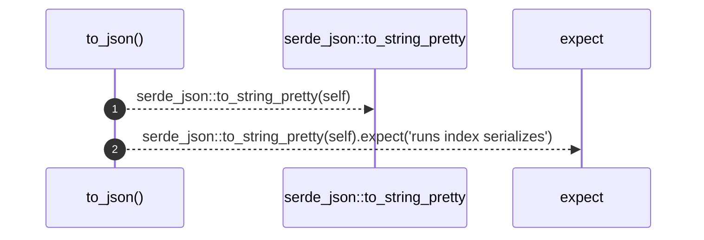

# `robby_render::runs::impl RunsIndex`

[Self-model](../../README.md) · [runs](index.md)

| | |
|---|---|
| kind | `code.impl` |
| location | [`crates/robby-render/src/runs.rs:107`](../../../../crates/robby-render/src/runs.rs#L107) |
| provenance | extractor · confidence 1.00 |

```rust
impl RunsIndex {
    pub fn to_json(&self) -> String {
        serde_json::to_string_pretty(self).expect("runs index serializes")
    }
}
```

### `to_json`

| | |
|---|---|
| kind | `code.method` |
| signature | `fn to_json(1)` |
| location | [`crates/robby-render/src/runs.rs:108`](../../../../crates/robby-render/src/runs.rs#L108) |
| provenance | extractor · confidence 1.00 |

```rust
pub fn to_json(&self) -> String {
        serde_json::to_string_pretty(self).expect("runs index serializes")
    }
```



2 steps · 0 observed · 2 possible only

