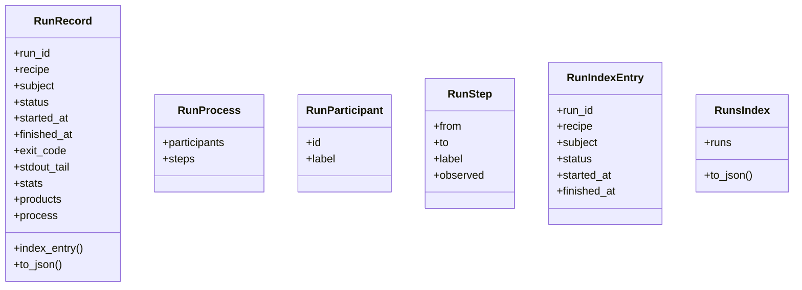
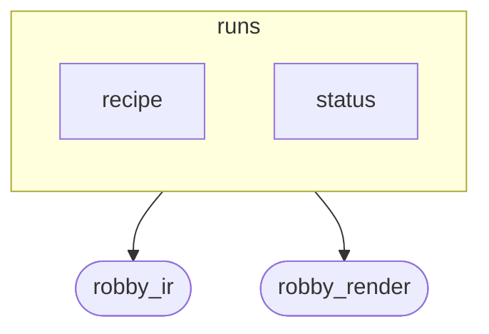
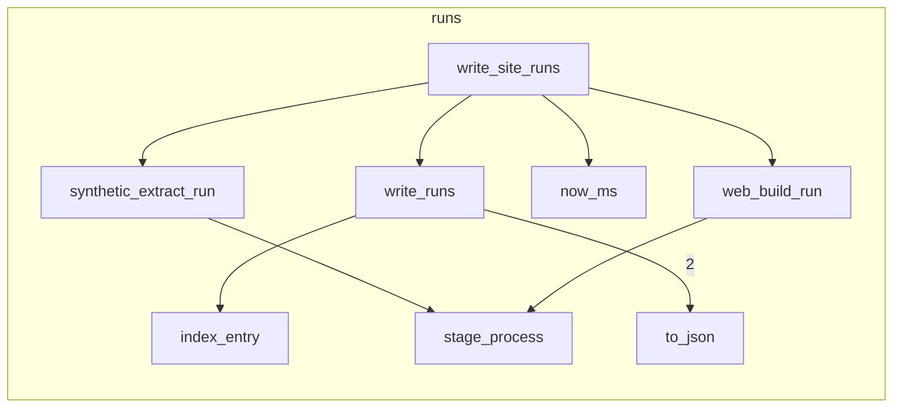

# `robby_render::runs`

[Self-model](../../README.md) · [robby_render](../index.md)

| | |
|---|---|
| kind | `code.module` |
| declared at | [`crates/robby-render/src/lib.rs:14`](../../../../crates/robby-render/src/lib.rs#L14) |
| provenance | extractor · confidence 1.00 |
| nodes | 59 |

## Types



## Package diagram



## Module coupling



## Dependency matrix

| | status | recipe | runs | robby_ir | robby_render |
|---|---:|---:|---:|---:|---:|
| **status** | · | | | | |
| **recipe** | | · | | | |
| **runs** | | | · | 8 | 7 |
| **robby_ir** | | | | · | |
| **robby_render** | | | | | · |

## Comments

- `crates/robby-render/src/runs.rs:143:1` (docs, `robby_render::runs::synthetic_extract_run`): "Synthetic completed extract from the loaded Document (retrospective history)."
  ```
  /// Synthetic completed extract from the loaded Document (retrospective history).
  pub fn synthetic_extract_run(doc: &Document, finished_at: u64) -> RunRecord {
      let started_at = finished_at.saturating_sub(5_000);
      let mut stats = serde_json::Map::new();
      stats.insert("nodes".into(), serde_json::json!(doc.nodes.len()));
      stats.insert("files".into(), serde_json::json!(doc.files.len()));
      stats.insert("roots".into(), serde_json::json!(doc.roots.len()));
      stats.insert("generator".into(), serde_json::json!(doc.generator));
      stats.insert("synthetic".into(), serde_json::json!(true));
  
      RunRecord {
          run_id: "synthetic-extract".to_owned(),
          recipe: recipe::EXTRACT.to_owned(),
          subject: "workspace:".to_owned(),
          status: status::PASS.to_owned(),
          started_at,
          finished_at,
          exit_code: Some(0),
          stdout_tail: Some(format!(
              "synthetic robby.extract from {} · {} nodes · {} files",
              doc.generator,
              doc.nodes.len(),
              doc.files.len()
          )),
          stats,
          products: vec!["path:.robby/robby.ir.json".to_owned()],
          process: Some(stage_process(&[
              "extract",
              "validate",
              "write_document",
          ])),
      }
  }
  ```
- `crates/robby-render/src/runs.rs:177:1` (docs, `robby_render::runs::web_build_run`): "Completed `robby.web` run for this site write."
  ```
  /// Completed `robby.web` run for this site write.
  pub fn web_build_run(doc: &Document, frames: usize, finished_at: u64) -> RunRecord {
      let started_at = finished_at.saturating_sub(500);
      let mut stats = serde_json::Map::new();
      stats.insert("frames".into(), serde_json::json!(frames));
      stats.insert("nodes".into(), serde_json::json!(doc.nodes.len()));
      stats.insert("files".into(), serde_json::json!(doc.files.len()));
  
      RunRecord {
          run_id: "latest-web".to_owned(),
          recipe: recipe::WEB.to_owned(),
          subject: "workspace:".to_owned(),
          status: status::PASS.to_owned(),
          started_at,
          finished_at,
          exit_code: Some(0),
          stdout_tail: Some(format!("wrote {frames} frame(s) to site public/")),
          stats,
          products: vec![
              "path:apps/site/public/scene.json".to_owned(),
              "path:apps/site/public/build.json".to_owned(),
              "path:apps/site/public/runs/index.json".to_owned(),
          ],
          process: Some(stage_process(&["load_ir", "scene", "frames", "runs"])),
      }
  }
  ```
- `crates/robby-render/src/runs.rs:204:1` (docs, `robby_render::runs::write_runs`): "Write `runs/<id>.json` + `runs/index.json` (newest first)."
  ```
  /// Write `runs/<id>.json` + `runs/index.json` (newest first).
  pub fn write_runs(out: &Path, records: &[RunRecord]) -> Result<()> {
      let runs_dir = out.join("runs");
      fs::create_dir_all(&runs_dir)?;
  
      let mut index = RunsIndex { runs: Vec::new() };
      for record in records {
          fs::write(
              runs_dir.join(format!("{}.json", record.run_id)),
              record.to_json(),
          )?;
          index.runs.push(record.index_entry());
      }
      // Newest finished_at first for the list.
      index.runs.sort_by(|a, b| b.finished_at.cmp(&a.finished_at));
      fs::write(runs_dir.join("index.json"), index.to_json())?;
      Ok(())
  }
  ```
- `crates/robby-render/src/runs.rs:223:1` (docs, `robby_render::runs::write_site_runs`): "Emit extract + web RunRecords under `out/runs` for a site rebuild."
  ```
  /// Emit extract + web RunRecords under `out/runs` for a site rebuild.
  pub fn write_site_runs(doc: &Document, out: &Path, frames: usize, rebuilt_at: u64) -> Result<()> {
      let finished = if rebuilt_at == 0 { now_ms() } else { rebuilt_at };
      let extract = synthetic_extract_run(doc, finished.saturating_sub(1_000));
      let web = web_build_run(doc, frames, finished);
      write_runs(out, &[extract, web])
  }
  ```
- `crates/robby-render/src/runs.rs:31:1` (docs, `robby_render::runs::RunRecord`): "One invocation — IR `agent.run` payload and/or `runs/<id>.json`."
  ```
  /// One invocation — IR `agent.run` payload and/or `runs/<id>.json`.
  #[derive(Debug, Clone, PartialEq, Serialize, Deserialize)]
  pub struct RunRecord {
      pub run_id: String,
      pub recipe: String,
      pub subject: String,
      pub status: String,
      pub started_at: u64,
      pub finished_at: u64,
      #[serde(skip_serializing_if = "Option::is_none")]
      pub exit_code: Option<i32>,
      #[serde(skip_serializing_if = "Option::is_none")]
      pub stdout_tail: Option<String>,
      #[serde(default, skip_serializing_if = "serde_json::Map::is_empty")]
      pub stats: serde_json::Map<String, serde_json::Value>,
      #[serde(default, skip_serializing_if = "Vec::is_empty")]
      pub products: Vec<String>,
      #[serde(skip_serializing_if = "Option::is_none")]
      pub process: Option<RunProcess>,
  }
  ```
- `crates/robby-render/src/runs.rs:52:1` (docs, `robby_render::runs::RunProcess`): "Coarse stage timeline for the invocation itself (not the subject body)."
  ```
  /// Coarse stage timeline for the invocation itself (not the subject body).
  #[derive(Debug, Clone, PartialEq, Serialize, Deserialize)]
  pub struct RunProcess {
      pub participants: Vec<RunParticipant>,
      pub steps: Vec<RunStep>,
  }
  ```
- `crates/robby-render/src/runs.rs:74:1` (docs, `robby_render::runs::RunIndexEntry`): "Compact row for `runs/index.json` (viewer list)."
  ```
  /// Compact row for `runs/index.json` (viewer list).
  #[derive(Debug, Clone, PartialEq, Serialize, Deserialize)]
  pub struct RunIndexEntry {
      pub run_id: String,
      pub recipe: String,
      pub subject: String,
      pub status: String,
      pub started_at: u64,
      pub finished_at: u64,
  }
  ```
## References

- calls → [`robby_ir::model`](../../robby_ir/model/index.md) — insert
- calls → [`robby_render::report`](../report/index.md) — new, push
- calls → [`robby_render::view::select`](../view/select/index.md) — collect

## Referenced by

- calls ← [`robby_render::test_web::entrypoints_scene_json_is_deterministic`](../test_web/entrypoints-scene-json-is-deterministic.md)
- calls ← [`robby_render::test_web::scene_json_is_byte_identical_across_runs`](../test_web/scene-json-is-byte-identical-across-runs.md)
- calls ← [`robby_render::web::write_site`](../web/write-site.md)

## Modules

- [`runs::status`](status/index.md) — 7 nodes
- [`runs::recipe`](recipe/index.md) — 3 nodes

## Items

| Item | Kind | Steps | Location |
|---|---|---:|---|
| [`RunRecord`](runrecord.md) | `code.struct` | — | `crates/robby-render/src/runs.rs:31:1` |
| [`RunProcess`](runprocess.md) | `code.struct` | — | `crates/robby-render/src/runs.rs:52:1` |
| [`RunParticipant`](runparticipant.md) | `code.struct` | — | `crates/robby-render/src/runs.rs:59:1` |
| [`RunStep`](runstep.md) | `code.struct` | — | `crates/robby-render/src/runs.rs:65:1` |
| [`RunIndexEntry`](runindexentry.md) | `code.struct` | — | `crates/robby-render/src/runs.rs:74:1` |
| [`RunsIndex`](runsindex.md) | `code.struct` | — | `crates/robby-render/src/runs.rs:85:1` |
| [`impl RunRecord`](impl-runrecord.md) | `code.impl` | — | `crates/robby-render/src/runs.rs:90:1` |
| [`impl RunsIndex`](impl-runsindex.md) | `code.impl` | — | `crates/robby-render/src/runs.rs:107:1` |
| [`now_ms`](now-ms.md) | `code.function` | 5 | `crates/robby-render/src/runs.rs:113:1` |
| [`stage_process`](stage-process.md) | `code.function` | 11 | `crates/robby-render/src/runs.rs:120:1` |
| [`synthetic_extract_run`](synthetic-extract-run.md) | `code.function` | 27 | `crates/robby-render/src/runs.rs:143:1` |
| [`web_build_run`](web-build-run.md) | `code.function` | 21 | `crates/robby-render/src/runs.rs:177:1` |
| [`write_runs`](write-runs.md) | `code.function` | 18 | `crates/robby-render/src/runs.rs:204:1` |
| [`write_site_runs`](write-site-runs.md) | `code.function` | 5 | `crates/robby-render/src/runs.rs:223:1` |

## Imports

- `use std::fs;`
- `use std::path::Path;`
- `use anyhow::Result;`
- `use serde::{Deserialize, Serialize};`
- [`use robby_ir::Document;`](../../robby_ir/index.md)

