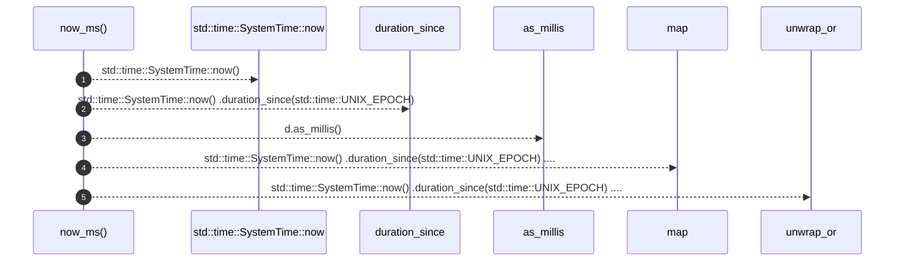

# `robby_render::runs::now_ms`

[Self-model](../../README.md) · [runs](index.md)

| | |
|---|---|
| kind | `code.function` |
| signature | `fn now_ms() -> u64` |
| location | [`crates/robby-render/src/runs.rs:113`](../../../../crates/robby-render/src/runs.rs#L113) |
| provenance | extractor · confidence 1.00 |

```rust
fn now_ms() -> u64 {
    std::time::SystemTime::now()
        .duration_since(std::time::UNIX_EPOCH)
        .map(|d| d.as_millis() as u64)
        .unwrap_or(0)
}
```



5 steps · 0 observed · 5 possible only

## Referenced by

- calls ← [`robby_render::runs::write_site_runs`](write-site-runs.md)

