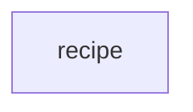

# `robby_render::runs::recipe`

[Self-model](../../../README.md) · [runs](../index.md)

| | |
|---|---|
| kind | `code.module` |
| declared at | [`crates/robby-render/src/runs.rs:25`](../../../../../crates/robby-render/src/runs.rs#L25) |
| provenance | extractor · confidence 1.00 |
| nodes | 3 |

## Package diagram

## Dependency matrix

| | recipe |
|---|---:|
| **recipe** | · |
## Items

| Item | Kind | Steps | Location |
|---|---|---:|---|
| [`EXTRACT`](extract.md) | `code.const` | — | `crates/robby-render/src/runs.rs:27:5` |
| [`WEB`](web.md) | `code.const` | — | `crates/robby-render/src/runs.rs:28:5` |

