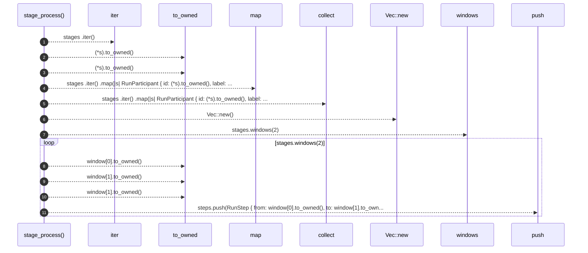

# `robby_render::runs::stage_process`

[Self-model](../../README.md) · [runs](index.md)

| | |
|---|---|
| kind | `code.function` |
| signature | `fn stage_process(stages: &[&str]) -> RunProcess` |
| location | [`crates/robby-render/src/runs.rs:120`](../../../../crates/robby-render/src/runs.rs#L120) |
| provenance | extractor · confidence 1.00 |

```rust
fn stage_process(stages: &[&str]) -> RunProcess {
    let participants: Vec<RunParticipant> = stages
        .iter()
        .map(|s| RunParticipant {
            id: (*s).to_owned(),
            label: (*s).to_owned(),
        })
        .collect();
    let mut steps = Vec::new();
    for window in stages.windows(2) {
        steps.push(RunStep {
            from: window[0].to_owned(),
            to: window[1].to_owned(),
            label: window[1].to_owned(),
            observed: true,
        });
    }
    RunProcess {
        participants,
        steps,
    }
}
```



11 steps · 0 observed · 11 possible only

**Edges**

- calls → [`robby_render::view::select::collect`](../view/select/collect.md)
- calls → [`robby_render::report::impl Report::new`](../report/index.md)
- calls → [`robby_render::report::impl Report::push`](../report/index.md)

## References

- calls → [`robby_render::report`](../report/index.md) — new, push
- calls → [`robby_render::view::select`](../view/select/index.md) — collect

## Referenced by

- calls ← [`robby_render::runs::synthetic_extract_run`](synthetic-extract-run.md)
- calls ← [`robby_render::runs::web_build_run`](web-build-run.md)

