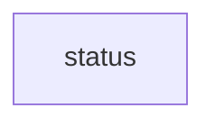

# `robby_render::runs::status`

[Self-model](../../../README.md) · [runs](../index.md)

| | |
|---|---|
| kind | `code.module` |
| declared at | [`crates/robby-render/src/runs.rs:15`](../../../../../crates/robby-render/src/runs.rs#L15) |
| provenance | extractor · confidence 1.00 |
| nodes | 7 |

## Package diagram

## Dependency matrix

| | status |
|---|---:|
| **status** | · |
## Items

| Item | Kind | Steps | Location |
|---|---|---:|---|
| [`QUEUED`](queued.md) | `code.const` | — | `crates/robby-render/src/runs.rs:17:5` |
| [`RUNNING`](running.md) | `code.const` | — | `crates/robby-render/src/runs.rs:18:5` |
| [`PASS`](pass.md) | `code.const` | — | `crates/robby-render/src/runs.rs:19:5` |
| [`FAIL`](fail.md) | `code.const` | — | `crates/robby-render/src/runs.rs:20:5` |
| [`ERROR`](error.md) | `code.const` | — | `crates/robby-render/src/runs.rs:21:5` |
| [`CANCELLED`](cancelled.md) | `code.const` | — | `crates/robby-render/src/runs.rs:22:5` |

