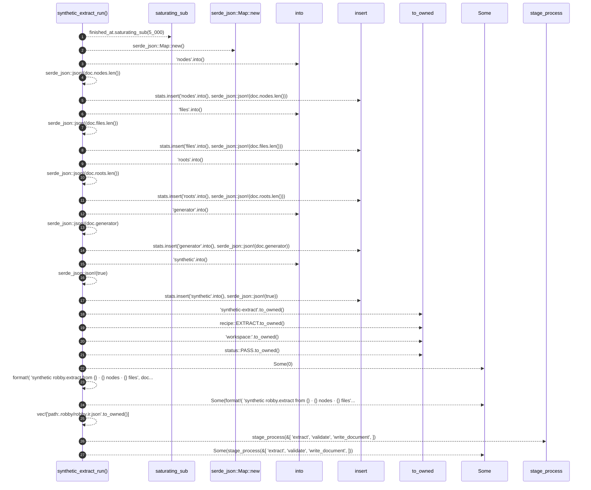

# `robby_render::runs::synthetic_extract_run`

[Self-model](../../README.md) · [runs](index.md)

| | |
|---|---|
| kind | `code.function` |
| signature | `fn synthetic_extract_run(doc: &Document, finished_at: u64) -> RunRecord` |
| location | [`crates/robby-render/src/runs.rs:143`](../../../../crates/robby-render/src/runs.rs#L143) |
| provenance | extractor · confidence 1.00 |

> Synthetic completed extract from the loaded Document (retrospective history).

```rust
/// Synthetic completed extract from the loaded Document (retrospective history).
pub fn synthetic_extract_run(doc: &Document, finished_at: u64) -> RunRecord {
    let started_at = finished_at.saturating_sub(5_000);
    let mut stats = serde_json::Map::new();
    stats.insert("nodes".into(), serde_json::json!(doc.nodes.len()));
    stats.insert("files".into(), serde_json::json!(doc.files.len()));
    stats.insert("roots".into(), serde_json::json!(doc.roots.len()));
    stats.insert("generator".into(), serde_json::json!(doc.generator));
    stats.insert("synthetic".into(), serde_json::json!(true));

    RunRecord {
        run_id: "synthetic-extract".to_owned(),
        recipe: recipe::EXTRACT.to_owned(),
        subject: "workspace:".to_owned(),
        status: status::PASS.to_owned(),
        started_at,
        finished_at,
        exit_code: Some(0),
        stdout_tail: Some(format!(
            "synthetic robby.extract from {} · {} nodes · {} files",
            doc.generator,
            doc.nodes.len(),
            doc.files.len()
        )),
        stats,
        products: vec!["path:.robby/robby.ir.json".to_owned()],
        process: Some(stage_process(&[
            "extract",
            "validate",
            "write_document",
        ])),
    }
}
```



27 steps · 0 observed · 27 possible only

**Edges**

- calls → [`robby_render::report::impl Report::new`](../report/index.md)
- calls → [`robby_ir::model::impl Document::insert`](../../robby_ir/model/index.md)
- calls → [`robby_ir::model::impl Document::insert`](../../robby_ir/model/index.md)
- calls → [`robby_ir::model::impl Document::insert`](../../robby_ir/model/index.md)
- calls → [`robby_ir::model::impl Document::insert`](../../robby_ir/model/index.md)
- calls → [`robby_ir::model::impl Document::insert`](../../robby_ir/model/index.md)
- calls → [`robby_render::runs::stage_process`](stage-process.md)

## References

- calls → [`robby_ir::model`](../../robby_ir/model/index.md) — insert
- calls → [`robby_render::report`](../report/index.md) — new
- calls → [`robby_render::runs`](index.md) — stage_process

## Referenced by

- calls ← [`robby_render::runs::write_site_runs`](write-site-runs.md)

