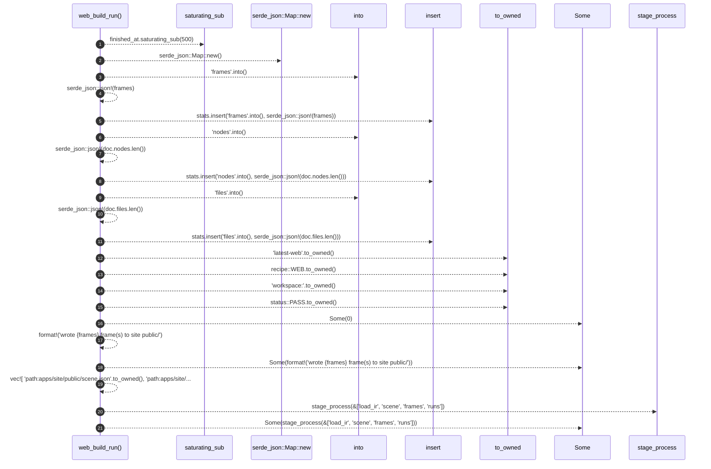

# `robby_render::runs::web_build_run`

[Self-model](../../README.md) · [runs](index.md)

| | |
|---|---|
| kind | `code.function` |
| signature | `fn web_build_run(doc: &Document, frames: usize, finished_at: u64) -> RunRecord` |
| location | [`crates/robby-render/src/runs.rs:177`](../../../../crates/robby-render/src/runs.rs#L177) |
| provenance | extractor · confidence 1.00 |

> Completed `robby.web` run for this site write.

```rust
/// Completed `robby.web` run for this site write.
pub fn web_build_run(doc: &Document, frames: usize, finished_at: u64) -> RunRecord {
    let started_at = finished_at.saturating_sub(500);
    let mut stats = serde_json::Map::new();
    stats.insert("frames".into(), serde_json::json!(frames));
    stats.insert("nodes".into(), serde_json::json!(doc.nodes.len()));
    stats.insert("files".into(), serde_json::json!(doc.files.len()));

    RunRecord {
        run_id: "latest-web".to_owned(),
        recipe: recipe::WEB.to_owned(),
        subject: "workspace:".to_owned(),
        status: status::PASS.to_owned(),
        started_at,
        finished_at,
        exit_code: Some(0),
        stdout_tail: Some(format!("wrote {frames} frame(s) to site public/")),
        stats,
        products: vec![
            "path:apps/site/public/scene.json".to_owned(),
            "path:apps/site/public/build.json".to_owned(),
            "path:apps/site/public/runs/index.json".to_owned(),
        ],
        process: Some(stage_process(&["load_ir", "scene", "frames", "runs"])),
    }
}
```



21 steps · 0 observed · 21 possible only

**Edges**

- calls → [`robby_render::report::impl Report::new`](../report/index.md)
- calls → [`robby_ir::model::impl Document::insert`](../../robby_ir/model/index.md)
- calls → [`robby_ir::model::impl Document::insert`](../../robby_ir/model/index.md)
- calls → [`robby_ir::model::impl Document::insert`](../../robby_ir/model/index.md)
- calls → [`robby_render::runs::stage_process`](stage-process.md)

## References

- calls → [`robby_ir::model`](../../robby_ir/model/index.md) — insert
- calls → [`robby_render::report`](../report/index.md) — new
- calls → [`robby_render::runs`](index.md) — stage_process

## Referenced by

- calls ← [`robby_render::runs::write_site_runs`](write-site-runs.md)

