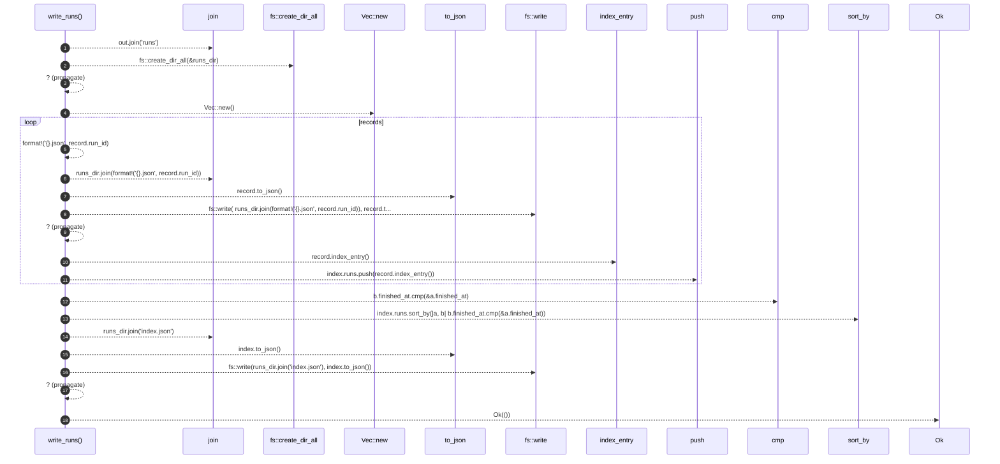

# `robby_render::runs::write_runs`

[Self-model](../../README.md) · [runs](index.md)

| | |
|---|---|
| kind | `code.function` |
| signature | `fn write_runs(out: &Path, records: &[RunRecord]) -> Result<()>` |
| location | [`crates/robby-render/src/runs.rs:204`](../../../../crates/robby-render/src/runs.rs#L204) |
| provenance | extractor · confidence 1.00 |

> Write `runs/<id>.json` + `runs/index.json` (newest first).

```rust
/// Write `runs/<id>.json` + `runs/index.json` (newest first).
pub fn write_runs(out: &Path, records: &[RunRecord]) -> Result<()> {
    let runs_dir = out.join("runs");
    fs::create_dir_all(&runs_dir)?;

    let mut index = RunsIndex { runs: Vec::new() };
    for record in records {
        fs::write(
            runs_dir.join(format!("{}.json", record.run_id)),
            record.to_json(),
        )?;
        index.runs.push(record.index_entry());
    }
    // Newest finished_at first for the list.
    index.runs.sort_by(|a, b| b.finished_at.cmp(&a.finished_at));
    fs::write(runs_dir.join("index.json"), index.to_json())?;
    Ok(())
}
```



18 steps · 0 observed · 18 possible only

**Edges**

- calls → [`robby_render::report::impl Report::new`](../report/index.md)
- calls → [`robby_render::runs::impl RunRecord::to_json`](index.md)
- calls → [`robby_render::runs::impl RunRecord::index_entry`](index.md)
- calls → [`robby_render::report::impl Report::push`](../report/index.md)
- calls → [`robby_render::runs::impl RunRecord::to_json`](index.md)

## References

- calls → [`robby_render::report`](../report/index.md) — new, push
- calls → [`robby_render::runs`](index.md) — index_entry, to_json

## Referenced by

- calls ← [`robby_render::runs::write_site_runs`](write-site-runs.md)

