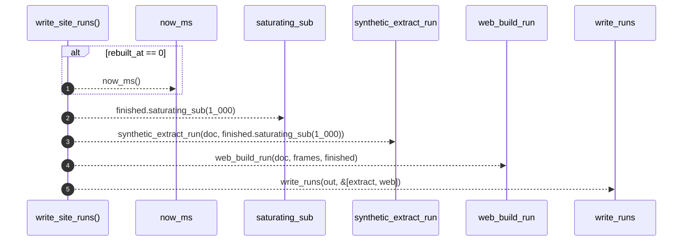

# `robby_render::runs::write_site_runs`

[Self-model](../../README.md) · [runs](index.md)

| | |
|---|---|
| kind | `code.function` |
| signature | `fn write_site_runs(doc: &Document, out: &Path, frames: usize, rebuilt_at: u64) -> Result<()>` |
| location | [`crates/robby-render/src/runs.rs:223`](../../../../crates/robby-render/src/runs.rs#L223) |
| provenance | extractor · confidence 1.00 |

> Emit extract + web RunRecords under `out/runs` for a site rebuild.

```rust
/// Emit extract + web RunRecords under `out/runs` for a site rebuild.
pub fn write_site_runs(doc: &Document, out: &Path, frames: usize, rebuilt_at: u64) -> Result<()> {
    let finished = if rebuilt_at == 0 { now_ms() } else { rebuilt_at };
    let extract = synthetic_extract_run(doc, finished.saturating_sub(1_000));
    let web = web_build_run(doc, frames, finished);
    write_runs(out, &[extract, web])
}
```



5 steps · 0 observed · 5 possible only

**Edges**

- calls → [`robby_render::runs::now_ms`](now-ms.md)
- calls → [`robby_render::runs::synthetic_extract_run`](synthetic-extract-run.md)
- calls → [`robby_render::runs::web_build_run`](web-build-run.md)
- calls → [`robby_render::runs::write_runs`](write-runs.md)

## References

- calls → [`robby_render::runs`](index.md) — now_ms, synthetic_extract_run, web_build_run, write_runs

## Referenced by

- calls ← [`robby_render::web::write_site`](../web/write-site.md)

