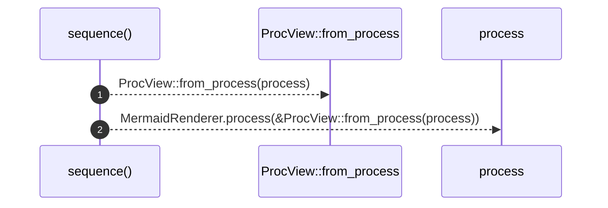

# `robby_render::sequence`

[Self-model](../README.md) · [robby_render](index.md)

| | |
|---|---|
| kind | `code.function` |
| signature | `fn sequence(process: &Process) -> String` |
| location | [`crates/robby-render/src/lib.rs:34`](../../../crates/robby-render/src/lib.rs#L34) |
| provenance | extractor · confidence 1.00 |

> Render a process as a Mermaid `sequenceDiagram`.

```rust
/// Render a process as a Mermaid `sequenceDiagram`.
pub fn sequence(process: &Process) -> String {
    MermaidRenderer.process(&ProcView::from_process(process))
}
```



2 steps · 0 observed · 2 possible only

**Edges**

- calls → [`robby_render::view::process::impl ProcessView::from_process`](view/process/index.md)
- calls → [`robby_render::test_render::process`](test_render/process.md)

## References

- calls → [`robby_render::test_render`](test_render/index.md) — process
- calls → [`robby_render::view::process`](view/process/index.md) — from_process

## Referenced by

- calls ← [`robby_render::all_sequences`](all-sequences.md)
- calls ← [`robby_render::markdown::node_section`](markdown/node-section.md)
- calls ← [`robby_render::test_render::emits_else_for_a_second_branch`](test_render/emits-else-for-a-second-branch.md)
- calls ← [`robby_render::test_render::nests_blocks_by_frame_stack`](test_render/nests-blocks-by-frame-stack.md)
- calls ← [`robby_render::test_render::opens_and_closes_alt_blocks`](test_render/opens-and-closes-alt-blocks.md)
- calls ← [`robby_render::test_render::renders_a_flat_sequence`](test_render/renders-a-flat-sequence.md)
- calls ← [`robby_render::test_render::unobserved_steps_use_dashed_arrows`](test_render/unobserved-steps-use-dashed-arrows.md)
- calls ← [`robby_render::tree::render_node`](tree/render-node.md)

