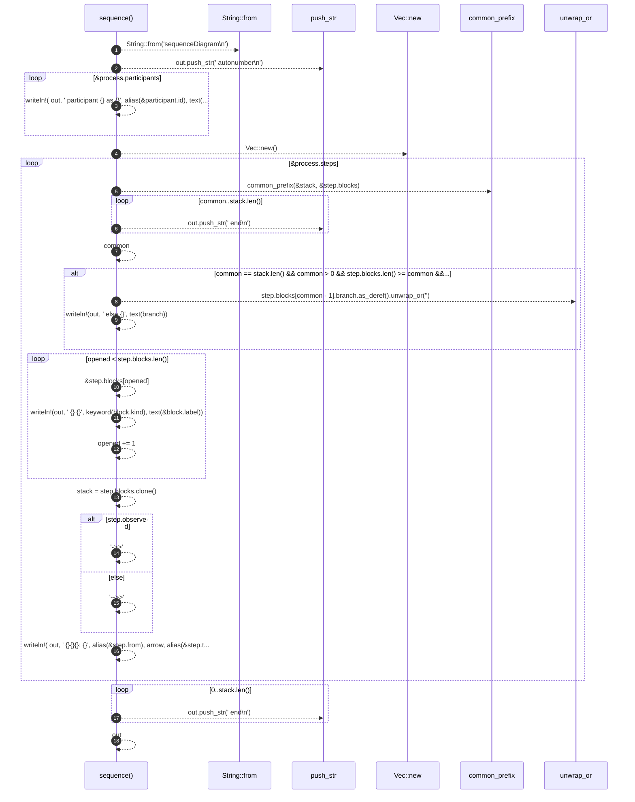

# `robby_render::sequence`

[Self-model](../README.md) · [robby_render](index.md)

| | |
|---|---|
| kind | `code.function` |
| signature | `fn sequence(process: &Process) -> String` |
| location | [`crates/robby-render/src/lib.rs:18`](../../../crates/robby-render/src/lib.rs#L18) |
| provenance | extractor · confidence 1.00 |

> Render a process as a Mermaid `sequenceDiagram`.
> 
> Observed steps use solid arrows; steps that are statically possible but were
> never observed use dashed arrows.

```rust
/// Render a process as a Mermaid `sequenceDiagram`.
///
/// Observed steps use solid arrows; steps that are statically possible but were
/// never observed use dashed arrows.
pub fn sequence(process: &Process) -> String {
    let mut out = String::from("sequenceDiagram\n");
    out.push_str("    autonumber\n");

    for participant in &process.participants {
        let _ = writeln!(
            out,
            "    participant {} as {}",
            alias(&participant.id),
            text(&participant.label)
        );
    }

    let mut stack: Vec<Block> = Vec::new();

    for step in &process.steps {
        let common = common_prefix(&stack, &step.blocks);

        // Close frames that ended before this step.
        for _ in common..stack.len() {
            out.push_str("    end\n");
        }

        // Same frame, different branch: emit `else` instead of reopening.
        let mut opened = common;
        if common == stack.len()
            && common > 0
            && step.blocks.len() >= common
            && step.blocks[common - 1].branch != stack[common - 1].branch
        {
            let branch = step.blocks[common - 1].branch.as_deref().unwrap_or("");
            let _ = writeln!(out, "    else {}", text(branch));
        }

        // Open frames that started at this step.
        while opened < step.blocks.len() {
            let block = &step.blocks[opened];
            let _ = writeln!(out, "    {} {}", keyword(block.kind), text(&block.label));
            opened += 1;
        }

        stack = step.blocks.clone();

        let arrow = if step.observed { "->>" } else { "-->>" };
        let _ = writeln!(
            out,
            "    {}{}{}: {}",
            alias(&step.from),
            arrow,
            alias(&step.to),
            text(&step.label)
        );
    }

    for _ in 0..stack.len() {
        out.push_str("    end\n");
    }

    out
}
```



18 steps · 0 observed · 18 possible only

**Edges**

- calls → [`robby_ir::kind::impl From<&str> for Kind::from`](../robby_ir/kind/index.md)
- calls → [`robby_extract::impl LineIndex::new`](../robby_extract/index.md)
- calls → [`robby_render::common_prefix`](common-prefix.md)

