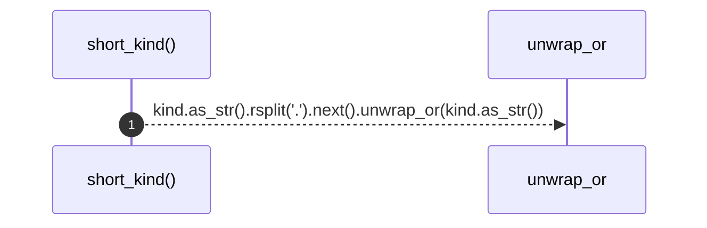

# `robby_render::short_kind`

[Self-model](../README.md) · [robby_render](index.md)

| | |
|---|---|
| kind | `code.function` |
| signature | `fn short_kind(kind: &robby_ir::Kind) -> &str` |
| location | [`crates/robby-render/src/lib.rs:194`](../../../crates/robby-render/src/lib.rs#L194) |
| provenance | extractor · confidence 1.00 |

```rust
fn short_kind(kind: &robby_ir::Kind) -> &str {
    kind.as_str().rsplit('.').next().unwrap_or(kind.as_str())
}
```



1 steps · 0 observed · 1 possible only

