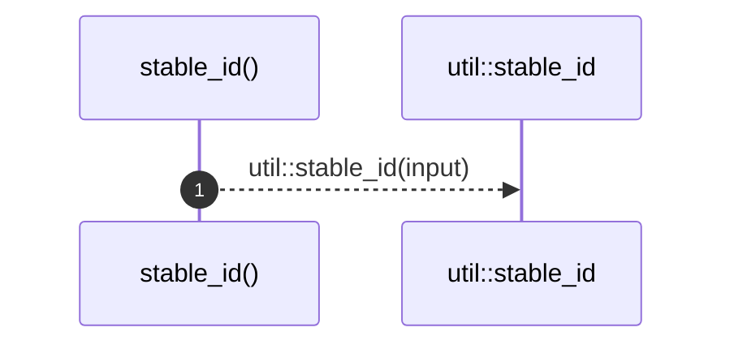

# `robby_render::stable_id`

[Self-model](../README.md) · [robby_render](index.md)

| | |
|---|---|
| kind | `code.function` |
| signature | `fn stable_id(input: &str) -> String` |
| location | [`crates/robby-render/src/lib.rs:99`](../../../crates/robby-render/src/lib.rs#L99) |
| provenance | extractor · confidence 1.00 |

> Stable Mermaid/layout id.

```rust
/// Stable Mermaid/layout id.
pub fn stable_id(input: &str) -> String {
    util::stable_id(input)
}
```



1 steps · 0 observed · 1 possible only

**Edges**

- calls → [`robby_render::stable_id`](stable-id.md)

## Referenced by

- calls ← [`robby_render::markdown::anchor`](markdown/anchor.md)
- calls ← [`robby_render::pipeline::slug`](pipeline/slug.md)
- calls ← [`robby_render::test_web::entrypoints_scene_roots_mains_and_nests_callees`](test_web/entrypoints-scene-roots-mains-and-nests-callees.md)
- calls ← [`robby_render::tree::item_slug`](tree/item-slug.md)
- calls ← [`robby_render::view::deps::impl CouplingGraph::from_root`](view/deps/index.md)
- calls ← [`robby_render::view::deps::impl CouplingGraph::workspace`](view/deps/index.md)
- calls ← [`robby_render::view::deps::impl PackageStructure::workspace`](view/deps/index.md)
- calls ← [`robby_render::view::deps::insert_module`](view/deps/insert-module.md)
- calls ← [`robby_render::view::deps::package_edges`](view/deps/package-edges.md)
- calls ← [`robby_render::view::deps::package_leaf`](view/deps/package-leaf.md)
- calls ← [`robby_render::view::scene::attach_call_portals`](view/scene/attach-call-portals.md)
- calls ← [`robby_render::view::scene::build_call_frame`](view/scene/build-call-frame.md)
- calls ← [`robby_render::view::scene::build_frame`](view/scene/build-frame.md)
- calls ← [`robby_render::view::scene::impl Scene::from_document`](view/scene/index.md)
- calls ← [`robby_render::view::scene::impl Scene::from_entrypoints`](view/scene/index.md)
- calls ← [`robby_render::view::scene::portals_for`](view/scene/portals-for.md)
- calls ← [`robby_render::view::sibling::impl SiblingGraph::from_root`](view/sibling/index.md)
- calls ← [`robby_render::web::impl FrameDetail::for_workspace`](web/index.md)
- calls ← [`robby_render::web::impl FrameDetail::from_node_in_doc`](web/index.md)

