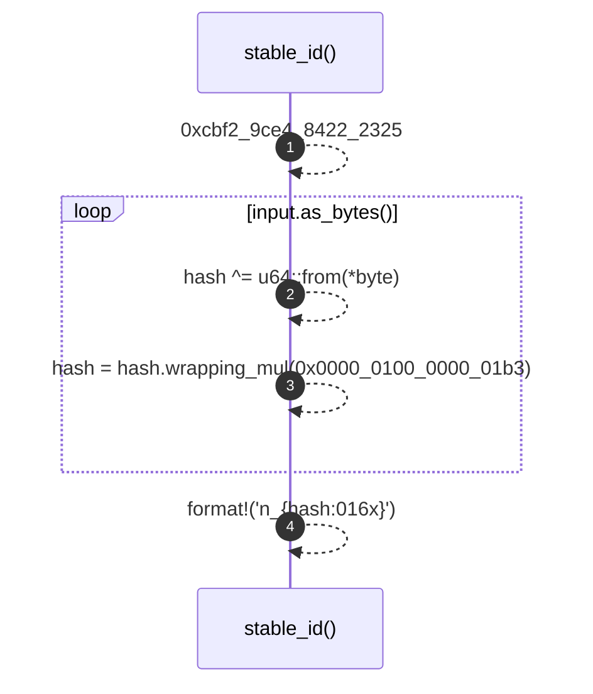

# `robby_render::stable_id`

[Self-model](../README.md) · [robby_render](index.md)

| | |
|---|---|
| kind | `code.function` |
| signature | `fn stable_id(input: &str) -> String` |
| location | [`crates/robby-render/src/lib.rs:198`](../../../crates/robby-render/src/lib.rs#L198) |
| provenance | extractor · confidence 1.00 |

> A stable, order-independent identifier derived from a node id.
> 
> FNV-1a, not `DefaultHasher`: `DefaultHasher` is explicitly allowed to change
> between releases, which would rewrite every diagram in the repository on a
> toolchain bump.

```rust
/// A stable, order-independent identifier derived from a node id.
///
/// FNV-1a, not `DefaultHasher`: `DefaultHasher` is explicitly allowed to change
/// between releases, which would rewrite every diagram in the repository on a
/// toolchain bump.
pub fn stable_id(input: &str) -> String {
    let mut hash: u64 = 0xcbf2_9ce4_8422_2325;
    for byte in input.as_bytes() {
        hash ^= u64::from(*byte);
        hash = hash.wrapping_mul(0x0000_0100_0000_01b3);
    }
    format!("n_{hash:016x}")
}
```



4 steps · 0 observed · 4 possible only

