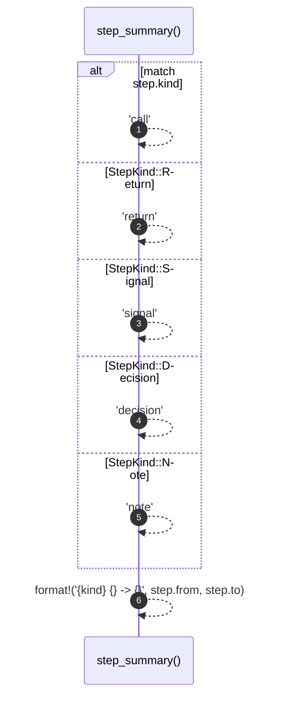

# `robby_render::step_summary`

[Self-model](../README.md) · [robby_render](index.md)

| | |
|---|---|
| kind | `code.function` |
| signature | `fn step_summary(step: &Step) -> String` |
| location | [`crates/robby-render/src/lib.rs:260`](../../../crates/robby-render/src/lib.rs#L260) |
| provenance | extractor · confidence 1.00 |

> Render a step as a compact one-liner, used by the site's step list.

```rust
/// Render a step as a compact one-liner, used by the site's step list.
pub fn step_summary(step: &Step) -> String {
    let kind = match step.kind {
        StepKind::Call => "call",
        StepKind::Return => "return",
        StepKind::Signal => "signal",
        StepKind::Decision => "decision",
        StepKind::Note => "note",
    };
    format!("{kind} {} -> {}", step.from, step.to)
}
```



6 steps · 0 observed · 6 possible only

