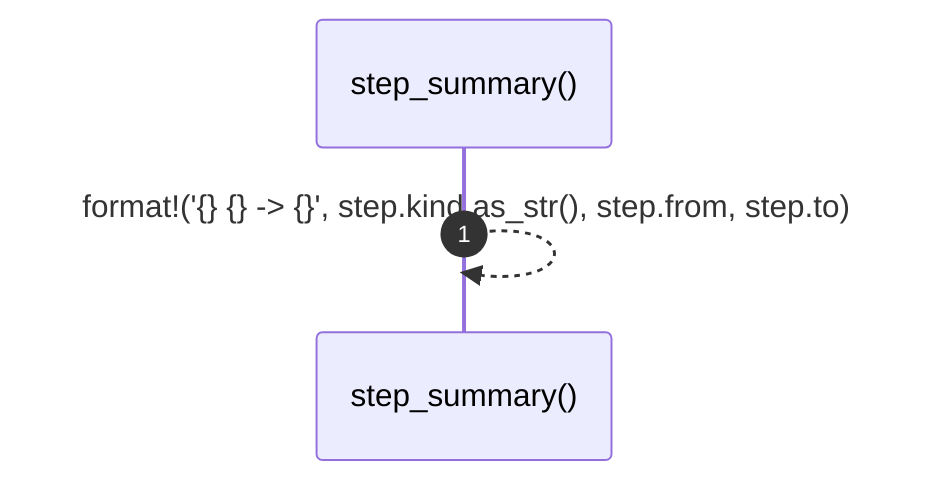

# `robby_render::step_summary`

[Self-model](../README.md) · [robby_render](index.md)

| | |
|---|---|
| kind | `code.function` |
| signature | `fn step_summary(step: &Step) -> String` |
| location | [`crates/robby-render/src/lib.rs:119`](../../../crates/robby-render/src/lib.rs#L119) |
| provenance | extractor · confidence 1.00 |

> Compact one-liner for a step.

```rust
/// Compact one-liner for a step.
pub fn step_summary(step: &Step) -> String {
    format!("{} {} -> {}", step.kind.as_str(), step.from, step.to)
}
```



1 steps · 0 observed · 1 possible only

