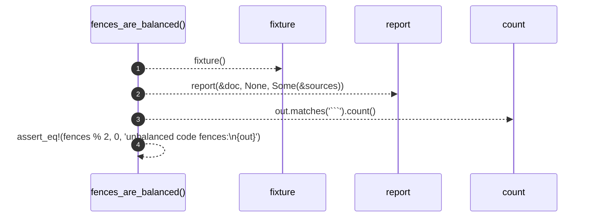

# `robby_render::test_markdown::fences_are_balanced`

[Self-model](../../README.md) · [test_markdown](index.md)

| | |
|---|---|
| kind | `code.function` |
| signature | `fn fences_are_balanced()` |
| location | [`crates/robby-render/tests/markdown.rs:67`](../../../../crates/robby-render/tests/markdown.rs#L67) |
| provenance | extractor · confidence 1.00 |

```rust
#[test]
fn fences_are_balanced() {
    let (doc, sources) = fixture();
    let out = report(&doc, None, Some(&sources));
    let fences = out.matches("```").count();
    assert_eq!(fences % 2, 0, "unbalanced code fences:\n{out}");
}
```



4 steps · 0 observed · 4 possible only

**Edges**

- calls → [`robby_render::test_markdown::fixture`](fixture.md)
- calls → [`robby_cli::report`](../../robby_cli/report.md)

