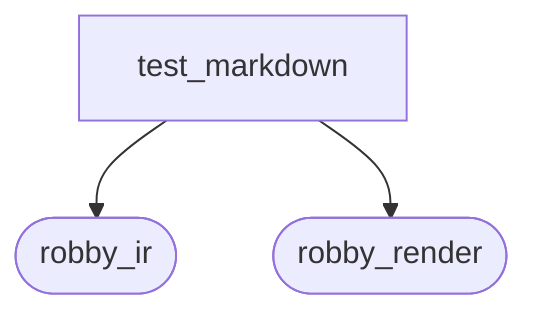
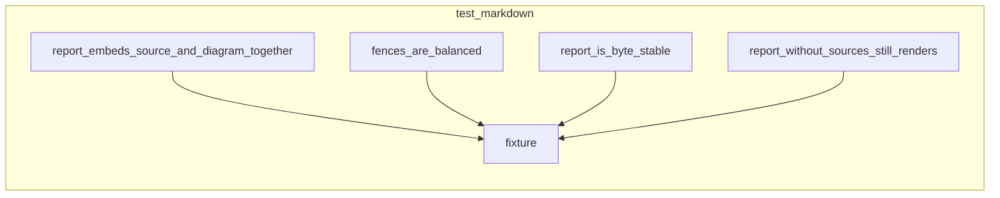

# `robby_render::test_markdown`

[Self-model](../../README.md) · [robby_render](../index.md)

| | |
|---|---|
| kind | `code.module` |
| provenance | extractor · confidence 1.00 |
| nodes | 12 |

## Package diagram

## Module coupling

## Dependency matrix

| | test_markdown | robby_ir | robby_render |
|---|---:|---:|---:|
| **test_markdown** | · | 12 | 13 |
| **robby_ir** | | · | |
| **robby_render** | | | · |
## References

- calls → [`robby_ir::kind`](../../robby_ir/kind/index.md) — from
- calls → [`robby_ir::model`](../../robby_ir/model/index.md) — insert, symbol
- calls → [`robby_ir::process`](../../robby_ir/process/index.md) — participant
- calls → [`robby_render::markdown`](../markdown/index.md) — report
- calls → [`robby_render::report`](../report/index.md) — new
- calls → [`robby_render::test_render`](../test_render/index.md) — step

## Items

| Item | Kind | Steps | Location |
|---|---|---:|---|
| [`SOURCE`](source.md) | `code.const` | — | `crates/robby-render/tests/markdown.rs:10:1` |
| [`fixture`](fixture.md) | `code.function` | 31 | `crates/robby-render/tests/markdown.rs:12:1` |
| [`report_is_byte_stable`](report-is-byte-stable.md) | `code.function` | 6 | `crates/robby-render/tests/markdown.rs:47:1` |
| [`report_embeds_source_and_diagram_together`](report-embeds-source-and-diagram-together.md) | `code.function` | 8 | `crates/robby-render/tests/markdown.rs:55:1` |
| [`fences_are_balanced`](fences-are-balanced.md) | `code.function` | 6 | `crates/robby-render/tests/markdown.rs:67:1` |
| [`report_without_sources_still_renders`](report-without-sources-still-renders.md) | `code.function` | 4 | `crates/robby-render/tests/markdown.rs:75:1` |
| [`unused_participant_import_is_referenced`](unused-participant-import-is-referenced.md) | `code.function` | 3 | `crates/robby-render/tests/markdown.rs:83:1` |

## Imports

- `use std::collections::BTreeMap;`
- [`use robby_ir::kind::code;`](../../robby_ir/kind/code/index.md)
- [`use robby_ir::{Document, Kind, Node, NodeId, Participant, Process, Source, Step, StepKind};`](../../robby_ir/index.md)
- [`use robby_render::markdown::report;`](../markdown/index.md)

