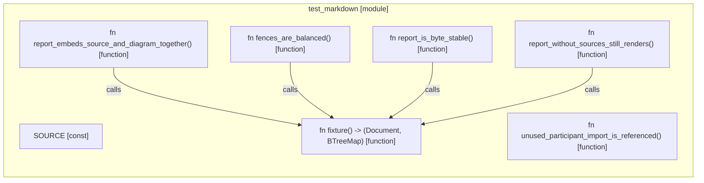

# `robby_render::test_markdown`

[Self-model](../../README.md) · [robby_render](../index.md)

| | |
|---|---|
| kind | `code.module` |
| provenance | extractor · confidence 1.00 |
| nodes | 12 |

## Items

| Item | Kind | Steps | Location |
|---|---|---:|---|
| [`SOURCE`](source.md) | `code.const` | — | `crates/robby-render/tests/markdown.rs:10:1` |
| [`fixture`](fixture.md) | `code.function` | 19 | `crates/robby-render/tests/markdown.rs:12:1` |
| [`report_is_byte_stable`](report-is-byte-stable.md) | `code.function` | 4 | `crates/robby-render/tests/markdown.rs:47:1` |
| [`report_embeds_source_and_diagram_together`](report-embeds-source-and-diagram-together.md) | `code.function` | 7 | `crates/robby-render/tests/markdown.rs:55:1` |
| [`fences_are_balanced`](fences-are-balanced.md) | `code.function` | 4 | `crates/robby-render/tests/markdown.rs:67:1` |
| [`report_without_sources_still_renders`](report-without-sources-still-renders.md) | `code.function` | 4 | `crates/robby-render/tests/markdown.rs:75:1` |
| [`unused_participant_import_is_referenced`](unused-participant-import-is-referenced.md) | `code.function` | 1 | `crates/robby-render/tests/markdown.rs:83:1` |

## Imports

- `use std::collections::BTreeMap;`
- `use robby_ir::kind::code;`
- `use robby_ir::{Document, Kind, Node, NodeId, Participant, Process, Source, Step, StepKind};`
- `use robby_render::markdown::report;`

