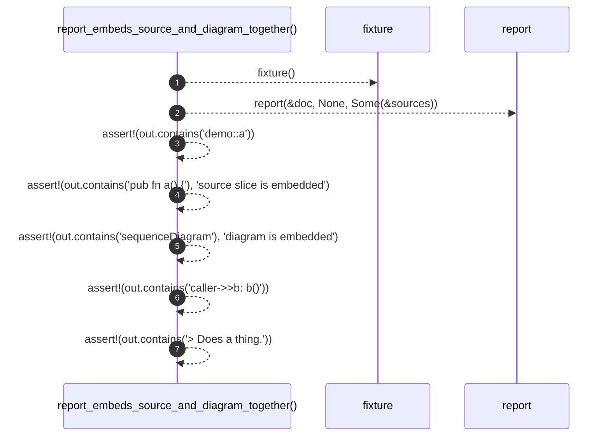

# `robby_render::test_markdown::report_embeds_source_and_diagram_together`

[Self-model](../../README.md) · [test_markdown](index.md)

| | |
|---|---|
| kind | `code.function` |
| signature | `fn report_embeds_source_and_diagram_together()` |
| location | [`crates/robby-render/tests/markdown.rs:55`](../../../../crates/robby-render/tests/markdown.rs#L55) |
| provenance | extractor · confidence 1.00 |

```rust
#[test]
fn report_embeds_source_and_diagram_together() {
    let (doc, sources) = fixture();
    let out = report(&doc, None, Some(&sources));

    assert!(out.contains("demo::a"));
    assert!(out.contains("pub fn a() {"), "source slice is embedded");
    assert!(out.contains("sequenceDiagram"), "diagram is embedded");
    assert!(out.contains("caller->>b: b()"));
    assert!(out.contains("> Does a thing."));
}
```



7 steps · 0 observed · 7 possible only

**Edges**

- calls → [`robby_render::test_markdown::fixture`](fixture.md)
- calls → [`robby_cli::report`](../../robby_cli/report.md)

