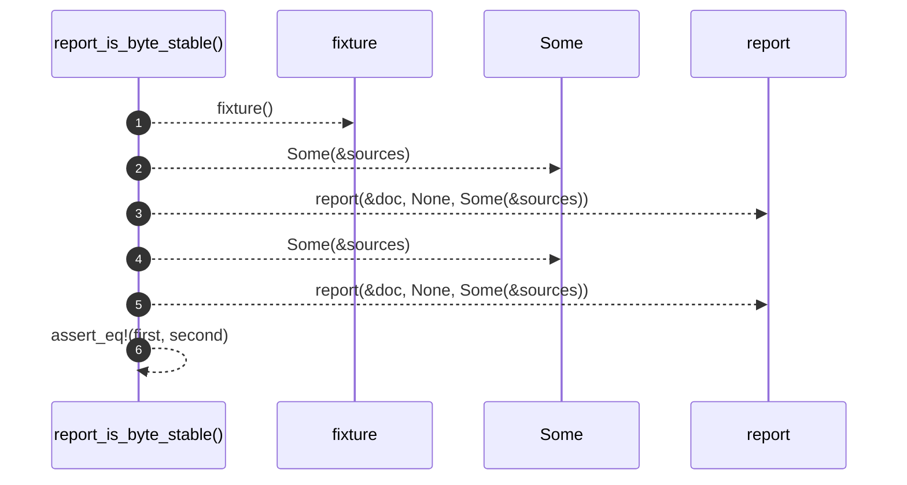

# `robby_render::test_markdown::report_is_byte_stable`

[Self-model](../../README.md) · [test_markdown](index.md)

| | |
|---|---|
| kind | `code.function` |
| signature | `fn report_is_byte_stable()` |
| location | [`crates/robby-render/tests/markdown.rs:47`](../../../../crates/robby-render/tests/markdown.rs#L47) |
| provenance | extractor · confidence 1.00 |

```rust
#[test]
fn report_is_byte_stable() {
    let (doc, sources) = fixture();
    let first = report(&doc, None, Some(&sources));
    let second = report(&doc, None, Some(&sources));
    assert_eq!(first, second);
}
```



6 steps · 0 observed · 6 possible only

**Edges**

- calls → [`robby_render::test_markdown::fixture`](fixture.md)
- calls → [`robby_render::markdown::report`](../markdown/report.md)
- calls → [`robby_render::markdown::report`](../markdown/report.md)

## References

- calls → [`robby_render::markdown`](../markdown/index.md) — report
- calls → [`robby_render::test_markdown`](index.md) — fixture

