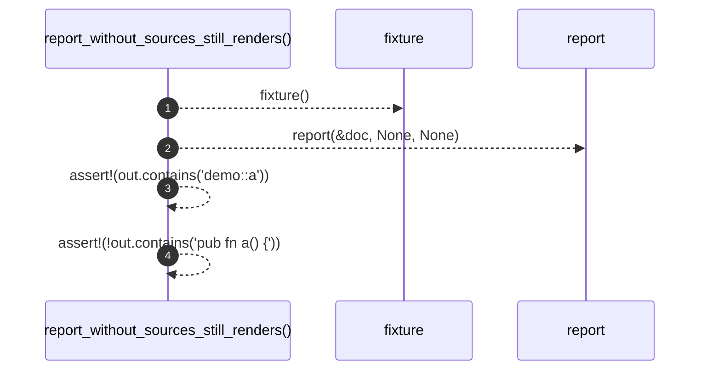

# `robby_render::test_markdown::report_without_sources_still_renders`

[Self-model](../../README.md) · [test_markdown](index.md)

| | |
|---|---|
| kind | `code.function` |
| signature | `fn report_without_sources_still_renders()` |
| location | [`crates/robby-render/tests/markdown.rs:75`](../../../../crates/robby-render/tests/markdown.rs#L75) |
| provenance | extractor · confidence 1.00 |

```rust
#[test]
fn report_without_sources_still_renders() {
    let (doc, _) = fixture();
    let out = report(&doc, None, None);
    assert!(out.contains("demo::a"));
    assert!(!out.contains("pub fn a() {"));
}
```



4 steps · 0 observed · 4 possible only

**Edges**

- calls → [`robby_render::test_markdown::fixture`](fixture.md)
- calls → [`robby_cli::report`](../../robby_cli/report.md)

