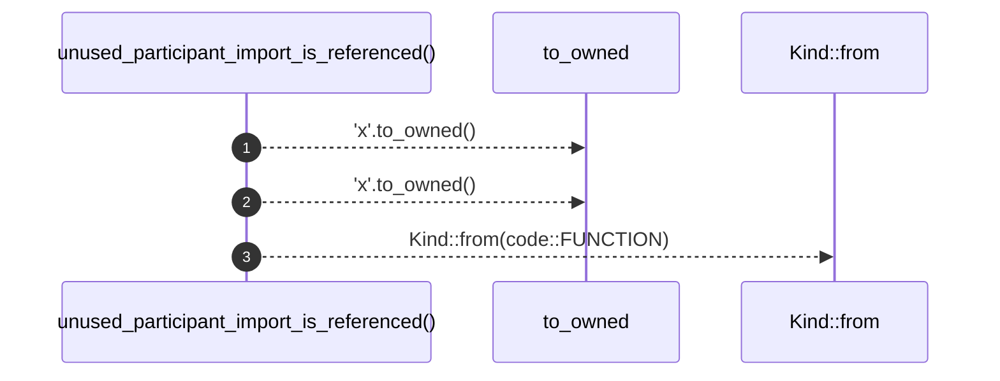

# `robby_render::test_markdown::unused_participant_import_is_referenced`

[Self-model](../../README.md) · [test_markdown](index.md)

| | |
|---|---|
| kind | `code.function` |
| signature | `fn unused_participant_import_is_referenced()` |
| location | [`crates/robby-render/tests/markdown.rs:83`](../../../../crates/robby-render/tests/markdown.rs#L83) |
| provenance | extractor · confidence 1.00 |

```rust
#[test]
fn unused_participant_import_is_referenced() {
    // Keeps the public API surface honest in this test crate.
    let _ = Participant {
        id: "x".to_owned(),
        label: "x".to_owned(),
        kind: Kind::from(code::FUNCTION),
    };
}
```



3 steps · 0 observed · 3 possible only

**Edges**

- calls → [`robby_ir::kind::impl From<&str> for Kind::from`](../../robby_ir/kind/index.md)

## References

- calls → [`robby_ir::kind`](../../robby_ir/kind/index.md) — from

