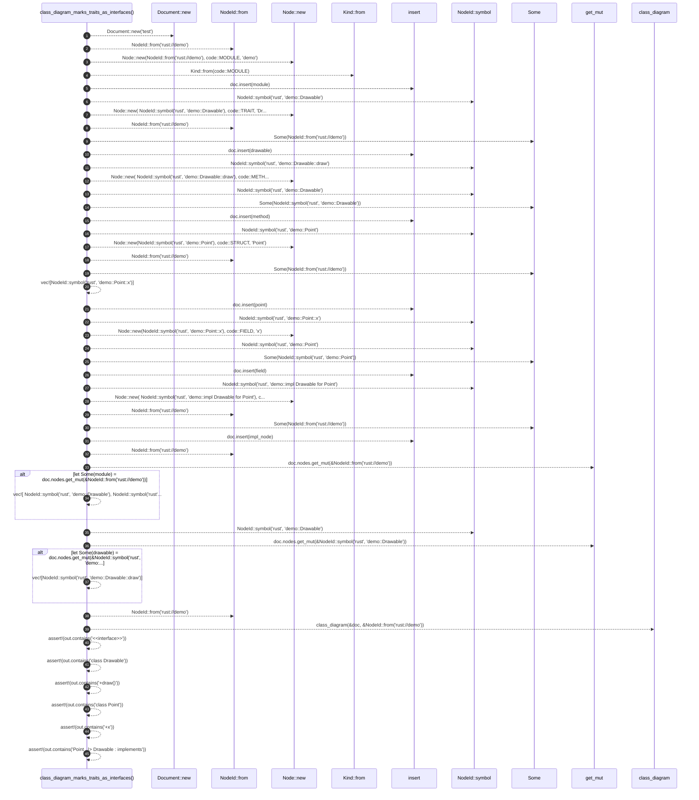

# `robby_render::test_render::class_diagram_marks_traits_as_interfaces`

[Self-model](../../README.md) · [test_render](index.md)

| | |
|---|---|
| kind | `code.function` |
| signature | `fn class_diagram_marks_traits_as_interfaces()` |
| location | [`crates/robby-render/tests/render.rs:469`](../../../../crates/robby-render/tests/render.rs#L469) |
| provenance | extractor · confidence 1.00 |

```rust
#[test]
fn class_diagram_marks_traits_as_interfaces() {
    let mut doc = Document::new("test");

    let mut module = Node::new(NodeId::from("rust://demo"), code::MODULE, "demo");
    module.kind = Kind::from(code::MODULE);
    doc.insert(module);

    let mut drawable = Node::new(
        NodeId::symbol("rust", "demo::Drawable"),
        code::TRAIT,
        "Drawable",
    );
    drawable.parent = Some(NodeId::from("rust://demo"));
    doc.insert(drawable);

    let mut method = Node::new(
        NodeId::symbol("rust", "demo::Drawable::draw"),
        code::METHOD,
        "draw",
    );
    method.parent = Some(NodeId::symbol("rust", "demo::Drawable"));
    doc.insert(method);

    let mut point = Node::new(NodeId::symbol("rust", "demo::Point"), code::STRUCT, "Point");
    point.parent = Some(NodeId::from("rust://demo"));
    point.children = vec![NodeId::symbol("rust", "demo::Point::x")];
    doc.insert(point);

    let mut field = Node::new(NodeId::symbol("rust", "demo::Point::x"), code::FIELD, "x");
    field.parent = Some(NodeId::symbol("rust", "demo::Point"));
    doc.insert(field);

    let mut impl_node = Node::new(
        NodeId::symbol("rust", "demo::impl Drawable for Point"),
        code::IMPL,
        "impl Drawable for Point",
    );
    impl_node.parent = Some(NodeId::from("rust://demo"));
    doc.insert(impl_node);

    if let Some(module) = doc.nodes.get_mut(&NodeId::from("rust://demo")) {
        module.children = vec![
            NodeId::symbol("rust", "demo::Drawable"),
            NodeId::symbol("rust", "demo::Point"),
            NodeId::symbol("rust", "demo::impl Drawable for Point"),
        ];
    }
    if let Some(drawable) = doc.nodes.get_mut(&NodeId::symbol("rust", "demo::Drawable")) {
        drawable.children = vec![NodeId::symbol("rust", "demo::Drawable::draw")];
    }

    let out = class_diagram(&doc, &NodeId::from("rust://demo"));
    assert!(out.contains("<<interface>>"));
    assert!(out.contains("class Drawable"));
    assert!(out.contains("+draw()"));
    assert!(out.contains("class Point"));
    assert!(out.contains("+x"));
    assert!(out.contains("Point ..|> Drawable : implements"));
}
```



45 steps · 0 observed · 45 possible only

**Edges**

- calls → [`robby_render::report::impl Report::new`](../report/index.md)
- calls → [`robby_ir::kind::impl From<&str> for Kind::from`](../../robby_ir/kind/index.md)
- calls → [`robby_render::report::impl Report::new`](../report/index.md)
- calls → [`robby_ir::kind::impl From<&str> for Kind::from`](../../robby_ir/kind/index.md)
- calls → [`robby_ir::model::impl Document::insert`](../../robby_ir/model/index.md)
- calls → [`robby_ir::model::impl NodeId::symbol`](../../robby_ir/model/index.md)
- calls → [`robby_render::report::impl Report::new`](../report/index.md)
- calls → [`robby_ir::kind::impl From<&str> for Kind::from`](../../robby_ir/kind/index.md)
- calls → [`robby_ir::model::impl Document::insert`](../../robby_ir/model/index.md)
- calls → [`robby_ir::model::impl NodeId::symbol`](../../robby_ir/model/index.md)
- calls → [`robby_render::report::impl Report::new`](../report/index.md)
- calls → [`robby_ir::model::impl NodeId::symbol`](../../robby_ir/model/index.md)
- calls → [`robby_ir::model::impl Document::insert`](../../robby_ir/model/index.md)
- calls → [`robby_ir::model::impl NodeId::symbol`](../../robby_ir/model/index.md)
- calls → [`robby_render::report::impl Report::new`](../report/index.md)
- calls → [`robby_ir::kind::impl From<&str> for Kind::from`](../../robby_ir/kind/index.md)
- calls → [`robby_ir::model::impl Document::insert`](../../robby_ir/model/index.md)
- calls → [`robby_ir::model::impl NodeId::symbol`](../../robby_ir/model/index.md)
- calls → [`robby_render::report::impl Report::new`](../report/index.md)
- calls → [`robby_ir::model::impl NodeId::symbol`](../../robby_ir/model/index.md)
- calls → [`robby_ir::model::impl Document::insert`](../../robby_ir/model/index.md)
- calls → [`robby_ir::model::impl NodeId::symbol`](../../robby_ir/model/index.md)
- calls → [`robby_render::report::impl Report::new`](../report/index.md)
- calls → [`robby_ir::kind::impl From<&str> for Kind::from`](../../robby_ir/kind/index.md)
- calls → [`robby_ir::model::impl Document::insert`](../../robby_ir/model/index.md)
- calls → [`robby_ir::kind::impl From<&str> for Kind::from`](../../robby_ir/kind/index.md)
- calls → [`robby_ir::model::impl NodeId::symbol`](../../robby_ir/model/index.md)
- calls → [`robby_ir::kind::impl From<&str> for Kind::from`](../../robby_ir/kind/index.md)
- calls → [`robby_render::class_diagram`](../class-diagram.md)

## References

- calls → [`robby_ir::kind`](../../robby_ir/kind/index.md) — from
- calls → [`robby_ir::model`](../../robby_ir/model/index.md) — insert, symbol
- calls → [`robby_render`](../index.md) — class_diagram
- calls → [`robby_render::report`](../report/index.md) — new

