# `robby_render::test_render::dependencies_emits_package_weighted_and_dsm`

[Self-model](../../README.md) · [test_render](index.md)

| | |
|---|---|
| kind | `code.function` |
| signature | `fn dependencies_emits_package_weighted_and_dsm()` |
| location | [`crates/robby-render/tests/render.rs:166`](../../../../crates/robby-render/tests/render.rs#L166) |
| provenance | extractor · confidence 1.00 |

```rust
#[test]
fn dependencies_emits_package_weighted_and_dsm() {
    let mut doc = Document::new("test");

    let mut krate = Node::new(NodeId::from("rust://demo"), code::CRATE, "demo");
    krate.kind = Kind::from(code::CRATE);
    doc.insert(krate);

    // Third arg is FQN (name is derived); mirror extractor shape.
    let mut left = Node::new(NodeId::symbol("rust", "demo::left"), code::MODULE, "demo::left");
    left.parent = Some(NodeId::from("rust://demo"));
    doc.insert(left);

    let mut right =
        Node::new(NodeId::symbol("rust", "demo::right"), code::MODULE, "demo::right");
    right.parent = Some(NodeId::from("rust://demo"));
    doc.insert(right);

    let mut point = Node::new(
        NodeId::symbol("rust", "demo::left::Point"),
        code::STRUCT,
        "demo::left::Point",
    );
    point.parent = Some(NodeId::symbol("rust", "demo::left"));
    doc.insert(point);

    let mut a = Node::new(
        NodeId::symbol("rust", "demo::left::a"),
        code::FUNCTION,
        "demo::left::a",
    );
    a.parent = Some(NodeId::symbol("rust", "demo::left"));
    doc.insert(a);

    let mut b = Node::new(
        NodeId::symbol("rust", "demo::right::b"),
        code::FUNCTION,
        "demo::right::b",
    );
    b.parent = Some(NodeId::symbol("rust", "demo::right"));
    b.edges
        .push(Edge::new(NodeId::symbol("rust", "demo::left::a"), EdgeKind::Calls));
    doc.insert(b);

    // Keep parent→child links consistent with how the extractor builds the tree.
    if let Some(krate) = doc.nodes.get_mut(&NodeId::from("rust://demo")) {
        krate.children = vec![
            NodeId::symbol("rust", "demo::left"),
            NodeId::symbol("rust", "demo::right"),
        ];
    }
    if let Some(left) = doc.nodes.get_mut(&NodeId::symbol("rust", "demo::left")) {
        left.children = vec![
            NodeId::symbol("rust", "demo::left::Point"),
            NodeId::symbol("rust", "demo::left::a"),
        ];
    }
    if let Some(right) = doc.nodes.get_mut(&NodeId::symbol("rust", "demo::right")) {
        right.children = vec![NodeId::symbol("rust", "demo::right::b")];
    }

    let out = dependencies(&doc, &NodeId::from("rust://demo"));

    assert!(out.starts_with("flowchart TB\n"));
    assert!(out.contains("subgraph"), "package diagram nests modules");
    assert!(out.contains("left"), "package digraph names modules");
    assert!(out.contains("right"), "package digraph names modules");
    assert!(
        !out.contains("Point"),
        "types belong in the class diagram, not module deps"
    );
    assert!(!out.contains("[\"a\"]"), "functions stay out of the package diagram");

    let coupled = coupling(&doc, &NodeId::from("rust://demo"));
    assert!(coupled.starts_with("flowchart TB\n"));
    assert!(coupled.contains("subgraph"), "coupling nests modules");
    assert!(coupled.contains("a"), "coupling shows callee");
    assert!(coupled.contains("b"), "coupling shows caller");
    assert!(coupled.contains("-->"), "coupling draws the call edge");
    assert!(!coupled.contains("Point"), "types stay out of coupling");

    let types = class_diagram(&doc, &NodeId::symbol("rust", "demo::left"));
    assert!(types.contains("classDiagram"));
    assert!(types.contains("class Point"));

    let workspace = workspace_dependencies(&doc);
    assert!(workspace.contains("Package diagram"));
    assert!(workspace.contains("Module coupling"));
    assert!(workspace.contains("Dependency matrix"));
    assert!(workspace.contains("demo"));
    assert!(!workspace.contains("Point"));
}
```

```mermaid
sequenceDiagram
    autonumber
    participant dependencies_emits_package_weighted_and_dsm as dependencies_emits_package_weighted_and_dsm()
    participant Document__new as Document::new
    participant NodeId__from as NodeId::from
    participant Node__new as Node::new
    participant Kind__from as Kind::from
    participant insert as insert
    participant NodeId__symbol as NodeId::symbol
    participant Some as Some
    participant Edge__new as Edge::new
    participant push as push
    participant get_mut as get_mut
    participant dependencies as dependencies
    participant coupling as coupling
    participant class_diagram as class_diagram
    participant workspace_dependencies as workspace_dependencies
    dependencies_emits_package_weighted_and_dsm-->>Document__new: Document::new('test')
    dependencies_emits_package_weighted_and_dsm-->>NodeId__from: NodeId::from('rust://demo')
    dependencies_emits_package_weighted_and_dsm-->>Node__new: Node::new(NodeId::from('rust://demo'), code::CRATE, 'demo')
    dependencies_emits_package_weighted_and_dsm-->>Kind__from: Kind::from(code::CRATE)
    dependencies_emits_package_weighted_and_dsm-->>insert: doc.insert(krate)
    dependencies_emits_package_weighted_and_dsm-->>NodeId__symbol: NodeId::symbol('rust', 'demo::left')
    dependencies_emits_package_weighted_and_dsm-->>Node__new: Node::new(NodeId::symbol('rust', 'demo::left'), code::MODULE, 'demo::...
    dependencies_emits_package_weighted_and_dsm-->>NodeId__from: NodeId::from('rust://demo')
    dependencies_emits_package_weighted_and_dsm-->>Some: Some(NodeId::from('rust://demo'))
    dependencies_emits_package_weighted_and_dsm-->>insert: doc.insert(left)
    dependencies_emits_package_weighted_and_dsm-->>NodeId__symbol: NodeId::symbol('rust', 'demo::right')
    dependencies_emits_package_weighted_and_dsm-->>Node__new: Node::new(NodeId::symbol('rust', 'demo::right'), code::MODULE, 'demo:...
    dependencies_emits_package_weighted_and_dsm-->>NodeId__from: NodeId::from('rust://demo')
    dependencies_emits_package_weighted_and_dsm-->>Some: Some(NodeId::from('rust://demo'))
    dependencies_emits_package_weighted_and_dsm-->>insert: doc.insert(right)
    dependencies_emits_package_weighted_and_dsm-->>NodeId__symbol: NodeId::symbol('rust', 'demo::left::Point')
    dependencies_emits_package_weighted_and_dsm-->>Node__new: Node::new( NodeId::symbol('rust', 'demo::left::Point'), code::STRUCT,...
    dependencies_emits_package_weighted_and_dsm-->>NodeId__symbol: NodeId::symbol('rust', 'demo::left')
    dependencies_emits_package_weighted_and_dsm-->>Some: Some(NodeId::symbol('rust', 'demo::left'))
    dependencies_emits_package_weighted_and_dsm-->>insert: doc.insert(point)
    dependencies_emits_package_weighted_and_dsm-->>NodeId__symbol: NodeId::symbol('rust', 'demo::left::a')
    dependencies_emits_package_weighted_and_dsm-->>Node__new: Node::new( NodeId::symbol('rust', 'demo::left::a'), code::FUNCTION, '...
    dependencies_emits_package_weighted_and_dsm-->>NodeId__symbol: NodeId::symbol('rust', 'demo::left')
    dependencies_emits_package_weighted_and_dsm-->>Some: Some(NodeId::symbol('rust', 'demo::left'))
    dependencies_emits_package_weighted_and_dsm-->>insert: doc.insert(a)
    dependencies_emits_package_weighted_and_dsm-->>NodeId__symbol: NodeId::symbol('rust', 'demo::right::b')
    dependencies_emits_package_weighted_and_dsm-->>Node__new: Node::new( NodeId::symbol('rust', 'demo::right::b'), code::FUNCTION, ...
    dependencies_emits_package_weighted_and_dsm-->>NodeId__symbol: NodeId::symbol('rust', 'demo::right')
    dependencies_emits_package_weighted_and_dsm-->>Some: Some(NodeId::symbol('rust', 'demo::right'))
    dependencies_emits_package_weighted_and_dsm-->>NodeId__symbol: NodeId::symbol('rust', 'demo::left::a')
    dependencies_emits_package_weighted_and_dsm-->>Edge__new: Edge::new(NodeId::symbol('rust', 'demo::left::a'), EdgeKind::Calls)
    dependencies_emits_package_weighted_and_dsm-->>push: b.edges .push(Edge::new(NodeId::symbol('rust', 'demo::left::a'), Edge...
    dependencies_emits_package_weighted_and_dsm-->>insert: doc.insert(b)
    dependencies_emits_package_weighted_and_dsm-->>NodeId__from: NodeId::from('rust://demo')
    dependencies_emits_package_weighted_and_dsm-->>get_mut: doc.nodes.get_mut(&NodeId::from('rust://demo'))
    alt let Some(krate) = doc.nodes.get_mut(&NodeId::from('rust://demo'))
    dependencies_emits_package_weighted_and_dsm-->>dependencies_emits_package_weighted_and_dsm: vec![ NodeId::symbol('rust', 'demo::left'), NodeId::symbol('rust', 'd...
    end
    dependencies_emits_package_weighted_and_dsm-->>NodeId__symbol: NodeId::symbol('rust', 'demo::left')
    dependencies_emits_package_weighted_and_dsm-->>get_mut: doc.nodes.get_mut(&NodeId::symbol('rust', 'demo::left'))
    alt let Some(left) = doc.nodes.get_mut(&NodeId::symbol('rust', 'demo::lef...
    dependencies_emits_package_weighted_and_dsm-->>dependencies_emits_package_weighted_and_dsm: vec![ NodeId::symbol('rust', 'demo::left::Point'), NodeId::symbol('ru...
    end
    dependencies_emits_package_weighted_and_dsm-->>NodeId__symbol: NodeId::symbol('rust', 'demo::right')
    dependencies_emits_package_weighted_and_dsm-->>get_mut: doc.nodes.get_mut(&NodeId::symbol('rust', 'demo::right'))
    alt let Some(right) = doc.nodes.get_mut(&NodeId::symbol('rust', 'demo::ri...
    dependencies_emits_package_weighted_and_dsm-->>dependencies_emits_package_weighted_and_dsm: vec![NodeId::symbol('rust', 'demo::right::b')]
    end
    dependencies_emits_package_weighted_and_dsm-->>NodeId__from: NodeId::from('rust://demo')
    dependencies_emits_package_weighted_and_dsm-->>dependencies: dependencies(&doc, &NodeId::from('rust://demo'))
    dependencies_emits_package_weighted_and_dsm-->>dependencies_emits_package_weighted_and_dsm: assert!(out.starts_with('flowchart TB\n'))
    dependencies_emits_package_weighted_and_dsm-->>dependencies_emits_package_weighted_and_dsm: assert!(out.contains('subgraph'), 'package diagram nests modules')
    dependencies_emits_package_weighted_and_dsm-->>dependencies_emits_package_weighted_and_dsm: assert!(out.contains('left'), 'package digraph names modules')
    dependencies_emits_package_weighted_and_dsm-->>dependencies_emits_package_weighted_and_dsm: assert!(out.contains('right'), 'package digraph names modules')
    dependencies_emits_package_weighted_and_dsm-->>dependencies_emits_package_weighted_and_dsm: assert!( !out.contains('Point'), 'types belong in the class diagram, ...
    dependencies_emits_package_weighted_and_dsm-->>dependencies_emits_package_weighted_and_dsm: assert!(!out.contains('[\'a\']'), 'functions stay out of the package ...
    dependencies_emits_package_weighted_and_dsm-->>NodeId__from: NodeId::from('rust://demo')
    dependencies_emits_package_weighted_and_dsm-->>coupling: coupling(&doc, &NodeId::from('rust://demo'))
    dependencies_emits_package_weighted_and_dsm-->>dependencies_emits_package_weighted_and_dsm: assert!(coupled.starts_with('flowchart TB\n'))
    dependencies_emits_package_weighted_and_dsm-->>dependencies_emits_package_weighted_and_dsm: assert!(coupled.contains('subgraph'), 'coupling nests modules')
    dependencies_emits_package_weighted_and_dsm-->>dependencies_emits_package_weighted_and_dsm: assert!(coupled.contains('a'), 'coupling shows callee')
    dependencies_emits_package_weighted_and_dsm-->>dependencies_emits_package_weighted_and_dsm: assert!(coupled.contains('b'), 'coupling shows caller')
    dependencies_emits_package_weighted_and_dsm-->>dependencies_emits_package_weighted_and_dsm: assert!(coupled.contains('-->'), 'coupling draws the call edge')
    dependencies_emits_package_weighted_and_dsm-->>dependencies_emits_package_weighted_and_dsm: assert!(!coupled.contains('Point'), 'types stay out of coupling')
    dependencies_emits_package_weighted_and_dsm-->>NodeId__symbol: NodeId::symbol('rust', 'demo::left')
    dependencies_emits_package_weighted_and_dsm-->>class_diagram: class_diagram(&doc, &NodeId::symbol('rust', 'demo::left'))
    dependencies_emits_package_weighted_and_dsm-->>dependencies_emits_package_weighted_and_dsm: assert!(types.contains('classDiagram'))
    dependencies_emits_package_weighted_and_dsm-->>dependencies_emits_package_weighted_and_dsm: assert!(types.contains('class Point'))
    dependencies_emits_package_weighted_and_dsm-->>workspace_dependencies: workspace_dependencies(&doc)
    dependencies_emits_package_weighted_and_dsm-->>dependencies_emits_package_weighted_and_dsm: assert!(workspace.contains('Package diagram'))
    dependencies_emits_package_weighted_and_dsm-->>dependencies_emits_package_weighted_and_dsm: assert!(workspace.contains('Module coupling'))
    dependencies_emits_package_weighted_and_dsm-->>dependencies_emits_package_weighted_and_dsm: assert!(workspace.contains('Dependency matrix'))
    dependencies_emits_package_weighted_and_dsm-->>dependencies_emits_package_weighted_and_dsm: assert!(workspace.contains('demo'))
    dependencies_emits_package_weighted_and_dsm-->>dependencies_emits_package_weighted_and_dsm: assert!(!workspace.contains('Point'))
```



68 steps · 0 observed · 68 possible only

**Edges**

- calls → [`robby_render::report::impl Report::new`](../report/index.md)
- calls → [`robby_ir::kind::impl From<&str> for Kind::from`](../../robby_ir/kind/index.md)
- calls → [`robby_render::report::impl Report::new`](../report/index.md)
- calls → [`robby_ir::kind::impl From<&str> for Kind::from`](../../robby_ir/kind/index.md)
- calls → [`robby_ir::model::impl Document::insert`](../../robby_ir/model/index.md)
- calls → [`robby_ir::model::impl NodeId::symbol`](../../robby_ir/model/index.md)
- calls → [`robby_render::report::impl Report::new`](../report/index.md)
- calls → [`robby_ir::kind::impl From<&str> for Kind::from`](../../robby_ir/kind/index.md)
- calls → [`robby_ir::model::impl Document::insert`](../../robby_ir/model/index.md)
- calls → [`robby_ir::model::impl NodeId::symbol`](../../robby_ir/model/index.md)
- calls → [`robby_render::report::impl Report::new`](../report/index.md)
- calls → [`robby_ir::kind::impl From<&str> for Kind::from`](../../robby_ir/kind/index.md)
- calls → [`robby_ir::model::impl Document::insert`](../../robby_ir/model/index.md)
- calls → [`robby_ir::model::impl NodeId::symbol`](../../robby_ir/model/index.md)
- calls → [`robby_render::report::impl Report::new`](../report/index.md)
- calls → [`robby_ir::model::impl NodeId::symbol`](../../robby_ir/model/index.md)
- calls → [`robby_ir::model::impl Document::insert`](../../robby_ir/model/index.md)
- calls → [`robby_ir::model::impl NodeId::symbol`](../../robby_ir/model/index.md)
- calls → [`robby_render::report::impl Report::new`](../report/index.md)
- calls → [`robby_ir::model::impl NodeId::symbol`](../../robby_ir/model/index.md)
- calls → [`robby_ir::model::impl Document::insert`](../../robby_ir/model/index.md)
- calls → [`robby_ir::model::impl NodeId::symbol`](../../robby_ir/model/index.md)
- calls → [`robby_render::report::impl Report::new`](../report/index.md)
- calls → [`robby_ir::model::impl NodeId::symbol`](../../robby_ir/model/index.md)
- calls → [`robby_ir::model::impl NodeId::symbol`](../../robby_ir/model/index.md)
- calls → [`robby_render::report::impl Report::new`](../report/index.md)
- calls → [`robby_render::report::impl Report::push`](../report/index.md)
- calls → [`robby_ir::model::impl Document::insert`](../../robby_ir/model/index.md)
- calls → [`robby_ir::kind::impl From<&str> for Kind::from`](../../robby_ir/kind/index.md)
- calls → [`robby_ir::model::impl NodeId::symbol`](../../robby_ir/model/index.md)
- calls → [`robby_ir::model::impl NodeId::symbol`](../../robby_ir/model/index.md)
- calls → [`robby_ir::kind::impl From<&str> for Kind::from`](../../robby_ir/kind/index.md)
- calls → [`robby_render::dependencies`](../dependencies.md)
- calls → [`robby_ir::kind::impl From<&str> for Kind::from`](../../robby_ir/kind/index.md)
- calls → [`robby_render::coupling`](../coupling.md)
- calls → [`robby_ir::model::impl NodeId::symbol`](../../robby_ir/model/index.md)
- calls → [`robby_render::class_diagram`](../class-diagram.md)
- calls → [`robby_render::workspace_dependencies`](../workspace-dependencies.md)

## References

- calls → [`robby_ir::kind`](../../robby_ir/kind/index.md) — from
- calls → [`robby_ir::model`](../../robby_ir/model/index.md) — insert, symbol
- calls → [`robby_render`](../index.md) — class_diagram, coupling, dependencies, workspace_dependencies
- calls → [`robby_render::report`](../report/index.md) — new, push

