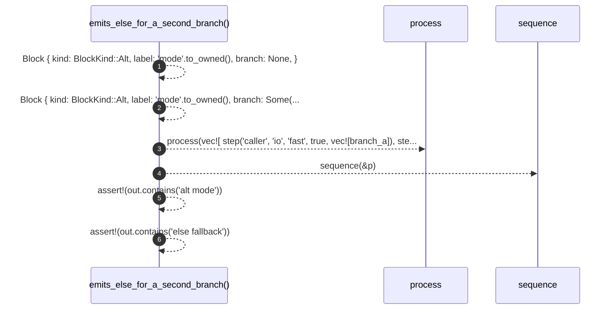

# `robby_render::test_render::emits_else_for_a_second_branch`

[Self-model](../../README.md) · [test_render](index.md)

| | |
|---|---|
| kind | `code.function` |
| signature | `fn emits_else_for_a_second_branch()` |
| location | [`crates/robby-render/tests/render.rs:72`](../../../../crates/robby-render/tests/render.rs#L72) |
| provenance | extractor · confidence 1.00 |

```rust
#[test]
fn emits_else_for_a_second_branch() {
    let branch_a = Block {
        kind: BlockKind::Alt,
        label: "mode".to_owned(),
        branch: None,
    };
    let branch_b = Block {
        kind: BlockKind::Alt,
        label: "mode".to_owned(),
        branch: Some("fallback".to_owned()),
    };
    let p = process(vec![
        step("caller", "io", "fast", true, vec![branch_a]),
        step("caller", "io", "slow", true, vec![branch_b]),
    ]);
    let out = sequence(&p);

    assert!(out.contains("alt mode"));
    assert!(out.contains("else fallback"));
}
```



6 steps · 0 observed · 6 possible only

**Edges**

- calls → [`robby_render::test_render::process`](process.md)
- calls → [`robby_render::sequence`](../sequence.md)

