# `robby_render::test_render::externals_and_comments_sections_render`

[Self-model](../../README.md) · [test_render](index.md)

| | |
|---|---|
| kind | `code.function` |
| signature | `fn externals_and_comments_sections_render()` |
| location | [`crates/robby-render/tests/render.rs:257`](../../../../crates/robby-render/tests/render.rs#L257) |
| provenance | extractor · confidence 1.00 |

```rust
#[test]
fn externals_and_comments_sections_render() {
    let mut doc = Document::new("test");

    let mut pkg = Node::new(NodeId::symbol("typescript", "demo"), code::PACKAGE, "demo");
    pkg.lang = robby_ir::Lang::TypeScript;
    doc.insert(pkg);

    let mut module = Node::new(
        NodeId::symbol("typescript", "demo/shapes"),
        code::MODULE,
        "demo/shapes",
    );
    module.parent = Some(NodeId::symbol("typescript", "demo"));
    doc.insert(module);

    let mut stub = Node::new(
        NodeId::symbol("typescript", "npm/demo-ext"),
        code::PACKAGE,
        "npm/demo-ext",
    );
    stub.lang = robby_ir::Lang::TypeScript;
    stub.tags.push("external".into());
    stub.annotations.insert("external".into(), "true".into());
    doc.insert(stub);

    let mut import = Node::new(
        NodeId::symbol("typescript", "demo/shapes/import:demo-ext"),
        code::IMPORT,
        "demo/shapes/import:demo-ext",
    );
    import.parent = Some(NodeId::symbol("typescript", "demo/shapes"));
    import.edges.push(Edge::new(
        NodeId::symbol("typescript", "npm/demo-ext"),
        EdgeKind::Imports,
    ));
    doc.insert(import);

    let mut comment = Node::new(
        NodeId::symbol("typescript", "demo/shapes/comment@0"),
        code::COMMENT,
        "demo/shapes/comment@0",
    );
    comment.parent = Some(NodeId::symbol("typescript", "demo/shapes"));
    comment.docs = Some("A drawable shape.".into());
    comment
        .annotations
        .insert("comment_kind".into(), "block".into());
    comment.span = Some(robby_ir::Span {
        file: "shapes.ts".into(),
        start: robby_ir::Position {
            byte: 0,
            line: 1,
            column: 1,
        },
        end: robby_ir::Position {
            byte: 20,
            line: 1,
            column: 21,
        },
    });
    doc.insert(comment);

    let mut decision = Node::new(
        NodeId::symbol("typescript", "demo/shapes/comment@0/decision"),
        robby_ir::kind::agent::DECISION,
        "demo/shapes/comment@0/decision",
    );
    decision.parent = Some(NodeId::symbol("typescript", "demo/shapes/comment@0"));
    decision.provenance = robby_ir::Provenance::new(robby_ir::Source::Agent);
    decision.docs = Some("Call draw() on implementors.".into());
    decision
        .annotations
        .insert("verdict".into(), "relevant".into());
    decision
        .annotations
        .insert("note_kind".into(), "usage_example".into());
    decision
        .annotations
        .insert("highlights".into(), r#"[{"start":0,"end":6}]"#.into());
    doc.insert(decision);

    let mut noise = Node::new(
        NodeId::symbol("typescript", "demo/shapes/comment@99"),
        code::COMMENT,
        "demo/shapes/comment@99",
    );
    noise.parent = Some(NodeId::symbol("typescript", "demo/shapes"));
    noise.docs = Some("TODO: delete me".into());
    noise
        .annotations
        .insert("comment_kind".into(), "line".into());
    doc.insert(noise);

    let mut noise_decision = Node::new(
        NodeId::symbol("typescript", "demo/shapes/comment@99/decision"),
        robby_ir::kind::agent::DECISION,
        "demo/shapes/comment@99/decision",
    );
    noise_decision.parent = Some(NodeId::symbol("typescript", "demo/shapes/comment@99"));
    noise_decision
        .annotations
        .insert("verdict".into(), "noise".into());
    doc.insert(noise_decision);

    let mut iface = Node::new(
        NodeId::symbol("typescript", "demo/shapes/Drawable"),
        code::INTERFACE,
        "demo/shapes/Drawable",
    );
    iface.parent = Some(NodeId::symbol("typescript", "demo/shapes"));
    iface.span = Some(robby_ir::Span {
        file: "shapes.ts".into(),
        start: robby_ir::Position {
            byte: 22,
            line: 2,
            column: 1,
        },
        end: robby_ir::Position {
            byte: 62,
            line: 4,
            column: 2,
        },
    });
    doc.insert(iface);

    let mut sources = std::collections::BTreeMap::new();
    sources.insert(
        "shapes.ts".into(),
        "/** A drawable shape. */\nexport interface Drawable {\n  draw(): void;\n}\n".into(),
    );

    let root = NodeId::symbol("typescript", "demo");
    let externals = ExternalsView::from_root(&doc, &root);
    assert!(!externals.is_empty());
    assert_eq!(externals.entries[0].package, "demo-ext");

    let comments = CommentsView::from_root(&doc, &root, Some(&sources));
    assert!(!comments.is_empty());
    assert!(
        comments.entries.iter().all(|e| e.text != "TODO: delete me"),
        "noise comments filtered"
    );
    let enriched = comments
        .entries
        .iter()
        .find(|e| e.note.is_some())
        .expect("enriched entry");
    assert!(
        enriched
            .code
            .as_ref()
            .is_some_and(|c| c.contains("Drawable"))
    );

    let md = MarkdownRenderer::new();
    let ext_body = md.externals(&externals);
    assert!(ext_body.contains("`demo-ext`"));
    assert!(ext_body.contains("imported by"));

    let cmt_body = md.comments(&comments);
    assert!(cmt_body.contains("usage example"));
    assert!(cmt_body.contains("Call draw()"));
    assert!(cmt_body.contains('«') && cmt_body.contains('»'));
    assert!(!cmt_body.contains("TODO: delete me"));

    let views = collect(
        &doc,
        doc.get(&root).expect("demo"),
        Some(&sources),
        &robby_render::SelectOpts::markdown(),
    );
    let report = md.report(&views).to_markdown();
    assert!(report.contains("## Externals"));
    assert!(report.contains("## Comments"));
}
```

```mermaid
sequenceDiagram
    autonumber
    participant externals_and_comments_sections_render as externals_and_comments_sections_render()
    participant Document__new as Document::new
    participant NodeId__symbol as NodeId::symbol
    participant Node__new as Node::new
    participant insert as insert
    participant Some as Some
    participant into as into
    participant push as push
    participant Edge__new as Edge::new
    participant robby_ir__Provenance__new as robby_ir::Provenance::new
    participant std__collections__BTreeMap__new as std::collections::BTreeMap::new
    participant ExternalsView__from_root as ExternalsView::from_root
    participant CommentsView__from_root as CommentsView::from_root
    participant iter as iter
    participant is_some as is_some
    participant find as find
    participant expect as expect
    participant MarkdownRenderer__new as MarkdownRenderer::new
    participant externals as externals
    participant comments as comments
    participant get as get
    participant robby_render__SelectOpts__markdown as robby_render::SelectOpts::markdown
    participant collect as collect
    participant report as report
    participant to_markdown as to_markdown
    externals_and_comments_sections_render-->>Document__new: Document::new('test')
    externals_and_comments_sections_render-->>NodeId__symbol: NodeId::symbol('typescript', 'demo')
    externals_and_comments_sections_render-->>Node__new: Node::new(NodeId::symbol('typescript', 'demo'), code::PACKAGE, 'demo')
    externals_and_comments_sections_render-->>insert: doc.insert(pkg)
    externals_and_comments_sections_render-->>NodeId__symbol: NodeId::symbol('typescript', 'demo/shapes')
    externals_and_comments_sections_render-->>Node__new: Node::new( NodeId::symbol('typescript', 'demo/shapes'), code::MODULE,...
    externals_and_comments_sections_render-->>NodeId__symbol: NodeId::symbol('typescript', 'demo')
    externals_and_comments_sections_render-->>Some: Some(NodeId::symbol('typescript', 'demo'))
    externals_and_comments_sections_render-->>insert: doc.insert(module)
    externals_and_comments_sections_render-->>NodeId__symbol: NodeId::symbol('typescript', 'npm/demo-ext')
    externals_and_comments_sections_render-->>Node__new: Node::new( NodeId::symbol('typescript', 'npm/demo-ext'), code::PACKAG...
    externals_and_comments_sections_render-->>into: 'external'.into()
    externals_and_comments_sections_render-->>push: stub.tags.push('external'.into())
    externals_and_comments_sections_render-->>into: 'external'.into()
    externals_and_comments_sections_render-->>into: 'true'.into()
    externals_and_comments_sections_render-->>insert: stub.annotations.insert('external'.into(), 'true'.into())
    externals_and_comments_sections_render-->>insert: doc.insert(stub)
    externals_and_comments_sections_render-->>NodeId__symbol: NodeId::symbol('typescript', 'demo/shapes/import:demo-ext')
    externals_and_comments_sections_render-->>Node__new: Node::new( NodeId::symbol('typescript', 'demo/shapes/import:demo-ext'...
    externals_and_comments_sections_render-->>NodeId__symbol: NodeId::symbol('typescript', 'demo/shapes')
    externals_and_comments_sections_render-->>Some: Some(NodeId::symbol('typescript', 'demo/shapes'))
    externals_and_comments_sections_render-->>NodeId__symbol: NodeId::symbol('typescript', 'npm/demo-ext')
    externals_and_comments_sections_render-->>Edge__new: Edge::new( NodeId::symbol('typescript', 'npm/demo-ext'), EdgeKind::Im...
    externals_and_comments_sections_render-->>push: import.edges.push(Edge::new( NodeId::symbol('typescript', 'npm/demo-e...
    externals_and_comments_sections_render-->>insert: doc.insert(import)
    externals_and_comments_sections_render-->>NodeId__symbol: NodeId::symbol('typescript', 'demo/shapes/comment@0')
    externals_and_comments_sections_render-->>Node__new: Node::new( NodeId::symbol('typescript', 'demo/shapes/comment@0'), cod...
    externals_and_comments_sections_render-->>NodeId__symbol: NodeId::symbol('typescript', 'demo/shapes')
    externals_and_comments_sections_render-->>Some: Some(NodeId::symbol('typescript', 'demo/shapes'))
    externals_and_comments_sections_render-->>into: 'A drawable shape.'.into()
    externals_and_comments_sections_render-->>Some: Some('A drawable shape.'.into())
    externals_and_comments_sections_render-->>into: 'comment_kind'.into()
    externals_and_comments_sections_render-->>into: 'block'.into()
    externals_and_comments_sections_render-->>insert: comment .annotations .insert('comment_kind'.into(), 'block'.into())
    externals_and_comments_sections_render-->>into: 'shapes.ts'.into()
    externals_and_comments_sections_render-->>Some: Some(robby_ir::Span { file: 'shapes.ts'.into(), start: robby_ir::Posi...
    externals_and_comments_sections_render-->>insert: doc.insert(comment)
    externals_and_comments_sections_render-->>NodeId__symbol: NodeId::symbol('typescript', 'demo/shapes/comment@0/decision')
    externals_and_comments_sections_render-->>Node__new: Node::new( NodeId::symbol('typescript', 'demo/shapes/comment@0/decisi...
    externals_and_comments_sections_render-->>NodeId__symbol: NodeId::symbol('typescript', 'demo/shapes/comment@0')
    externals_and_comments_sections_render-->>Some: Some(NodeId::symbol('typescript', 'demo/shapes/comment@0'))
    externals_and_comments_sections_render-->>robby_ir__Provenance__new: robby_ir::Provenance::new(robby_ir::Source::Agent)
    externals_and_comments_sections_render-->>into: 'Call draw() on implementors.'.into()
    externals_and_comments_sections_render-->>Some: Some('Call draw() on implementors.'.into())
    externals_and_comments_sections_render-->>into: 'verdict'.into()
    externals_and_comments_sections_render-->>into: 'relevant'.into()
    externals_and_comments_sections_render-->>insert: decision .annotations .insert('verdict'.into(), 'relevant'.into())
    externals_and_comments_sections_render-->>into: 'note_kind'.into()
    externals_and_comments_sections_render-->>into: 'usage_example'.into()
    externals_and_comments_sections_render-->>insert: decision .annotations .insert('note_kind'.into(), 'usage_example'.int...
    externals_and_comments_sections_render-->>into: 'highlights'.into()
    externals_and_comments_sections_render-->>into: r '[{'start':0,'end':6}]' .into()
    externals_and_comments_sections_render-->>insert: decision .annotations .insert('highlights'.into(), r '[{'start':0,'en...
    externals_and_comments_sections_render-->>insert: doc.insert(decision)
    externals_and_comments_sections_render-->>NodeId__symbol: NodeId::symbol('typescript', 'demo/shapes/comment@99')
    externals_and_comments_sections_render-->>Node__new: Node::new( NodeId::symbol('typescript', 'demo/shapes/comment@99'), co...
    externals_and_comments_sections_render-->>NodeId__symbol: NodeId::symbol('typescript', 'demo/shapes')
    externals_and_comments_sections_render-->>Some: Some(NodeId::symbol('typescript', 'demo/shapes'))
    externals_and_comments_sections_render-->>into: 'TODO: delete me'.into()
    externals_and_comments_sections_render-->>Some: Some('TODO: delete me'.into())
    externals_and_comments_sections_render-->>into: 'comment_kind'.into()
    externals_and_comments_sections_render-->>into: 'line'.into()
    externals_and_comments_sections_render-->>insert: noise .annotations .insert('comment_kind'.into(), 'line'.into())
    externals_and_comments_sections_render-->>insert: doc.insert(noise)
    externals_and_comments_sections_render-->>NodeId__symbol: NodeId::symbol('typescript', 'demo/shapes/comment@99/decision')
    externals_and_comments_sections_render-->>Node__new: Node::new( NodeId::symbol('typescript', 'demo/shapes/comment@99/decis...
    externals_and_comments_sections_render-->>NodeId__symbol: NodeId::symbol('typescript', 'demo/shapes/comment@99')
    externals_and_comments_sections_render-->>Some: Some(NodeId::symbol('typescript', 'demo/shapes/comment@99'))
    externals_and_comments_sections_render-->>into: 'verdict'.into()
    externals_and_comments_sections_render-->>into: 'noise'.into()
    externals_and_comments_sections_render-->>insert: noise_decision .annotations .insert('verdict'.into(), 'noise'.into())
    externals_and_comments_sections_render-->>insert: doc.insert(noise_decision)
    externals_and_comments_sections_render-->>NodeId__symbol: NodeId::symbol('typescript', 'demo/shapes/Drawable')
    externals_and_comments_sections_render-->>Node__new: Node::new( NodeId::symbol('typescript', 'demo/shapes/Drawable'), code...
    externals_and_comments_sections_render-->>NodeId__symbol: NodeId::symbol('typescript', 'demo/shapes')
    externals_and_comments_sections_render-->>Some: Some(NodeId::symbol('typescript', 'demo/shapes'))
    externals_and_comments_sections_render-->>into: 'shapes.ts'.into()
    externals_and_comments_sections_render-->>Some: Some(robby_ir::Span { file: 'shapes.ts'.into(), start: robby_ir::Posi...
    externals_and_comments_sections_render-->>insert: doc.insert(iface)
    externals_and_comments_sections_render-->>std__collections__BTreeMap__new: std::collections::BTreeMap::new()
    externals_and_comments_sections_render-->>into: 'shapes.ts'.into()
    externals_and_comments_sections_render-->>into: '/** A drawable shape. */\nexport interface Drawable {\n draw(): void...
    externals_and_comments_sections_render-->>insert: sources.insert( 'shapes.ts'.into(), '/** A drawable shape. */\nexport...
    externals_and_comments_sections_render-->>NodeId__symbol: NodeId::symbol('typescript', 'demo')
    externals_and_comments_sections_render-->>ExternalsView__from_root: ExternalsView::from_root(&doc, &root)
    externals_and_comments_sections_render-->>externals_and_comments_sections_render: assert!(!externals.is_empty())
    externals_and_comments_sections_render-->>externals_and_comments_sections_render: assert_eq!(externals.entries[0].package, 'demo-ext')
    externals_and_comments_sections_render-->>Some: Some(&sources)
    externals_and_comments_sections_render-->>CommentsView__from_root: CommentsView::from_root(&doc, &root, Some(&sources))
    externals_and_comments_sections_render-->>externals_and_comments_sections_render: assert!(!comments.is_empty())
    externals_and_comments_sections_render-->>externals_and_comments_sections_render: assert!( comments.entries.iter().all(|e| e.text != 'TODO: delete me')...
    externals_and_comments_sections_render-->>iter: comments .entries .iter()
    externals_and_comments_sections_render-->>is_some: e.note.is_some()
    externals_and_comments_sections_render-->>find: comments .entries .iter() .find(|e| e.note.is_some())
    externals_and_comments_sections_render-->>expect: comments .entries .iter() .find(|e| e.note.is_some()) .expect('enrich...
    externals_and_comments_sections_render-->>externals_and_comments_sections_render: assert!( enriched .code .as_ref() .is_some_and(|c| c.contains('Drawab...
    externals_and_comments_sections_render-->>MarkdownRenderer__new: MarkdownRenderer::new()
    externals_and_comments_sections_render-->>externals: md.externals(&externals)
    externals_and_comments_sections_render-->>externals_and_comments_sections_render: assert!(ext_body.contains('`demo-ext`'))
    externals_and_comments_sections_render-->>externals_and_comments_sections_render: assert!(ext_body.contains('imported by'))
    externals_and_comments_sections_render-->>comments: md.comments(&comments)
    externals_and_comments_sections_render-->>externals_and_comments_sections_render: assert!(cmt_body.contains('usage example'))
    externals_and_comments_sections_render-->>externals_and_comments_sections_render: assert!(cmt_body.contains('Call draw()'))
    externals_and_comments_sections_render-->>externals_and_comments_sections_render: assert!(cmt_body.contains('«') && cmt_body.contains('»'))
    externals_and_comments_sections_render-->>externals_and_comments_sections_render: assert!(!cmt_body.contains('TODO: delete me'))
    externals_and_comments_sections_render-->>get: doc.get(&root)
    externals_and_comments_sections_render-->>expect: doc.get(&root).expect('demo')
    externals_and_comments_sections_render-->>Some: Some(&sources)
    externals_and_comments_sections_render-->>robby_render__SelectOpts__markdown: robby_render::SelectOpts::markdown()
    externals_and_comments_sections_render-->>collect: collect( &doc, doc.get(&root).expect('demo'), Some(&sources), &robby_...
    externals_and_comments_sections_render-->>report: md.report(&views)
    externals_and_comments_sections_render-->>to_markdown: md.report(&views).to_markdown()
    externals_and_comments_sections_render-->>externals_and_comments_sections_render: assert!(report.contains(' Externals'))
    externals_and_comments_sections_render-->>externals_and_comments_sections_render: assert!(report.contains(' Comments'))
```



114 steps · 0 observed · 114 possible only

**Edges**

- calls → [`robby_render::report::impl Report::new`](../report/index.md)
- calls → [`robby_ir::model::impl NodeId::symbol`](../../robby_ir/model/index.md)
- calls → [`robby_render::report::impl Report::new`](../report/index.md)
- calls → [`robby_ir::model::impl Document::insert`](../../robby_ir/model/index.md)
- calls → [`robby_ir::model::impl NodeId::symbol`](../../robby_ir/model/index.md)
- calls → [`robby_render::report::impl Report::new`](../report/index.md)
- calls → [`robby_ir::model::impl NodeId::symbol`](../../robby_ir/model/index.md)
- calls → [`robby_ir::model::impl Document::insert`](../../robby_ir/model/index.md)
- calls → [`robby_ir::model::impl NodeId::symbol`](../../robby_ir/model/index.md)
- calls → [`robby_render::report::impl Report::new`](../report/index.md)
- calls → [`robby_render::report::impl Report::push`](../report/index.md)
- calls → [`robby_ir::model::impl Document::insert`](../../robby_ir/model/index.md)
- calls → [`robby_ir::model::impl Document::insert`](../../robby_ir/model/index.md)
- calls → [`robby_ir::model::impl NodeId::symbol`](../../robby_ir/model/index.md)
- calls → [`robby_render::report::impl Report::new`](../report/index.md)
- calls → [`robby_ir::model::impl NodeId::symbol`](../../robby_ir/model/index.md)
- calls → [`robby_ir::model::impl NodeId::symbol`](../../robby_ir/model/index.md)
- calls → [`robby_render::report::impl Report::new`](../report/index.md)
- calls → [`robby_render::report::impl Report::push`](../report/index.md)
- calls → [`robby_ir::model::impl Document::insert`](../../robby_ir/model/index.md)
- calls → [`robby_ir::model::impl NodeId::symbol`](../../robby_ir/model/index.md)
- calls → [`robby_render::report::impl Report::new`](../report/index.md)
- calls → [`robby_ir::model::impl NodeId::symbol`](../../robby_ir/model/index.md)
- calls → [`robby_ir::model::impl Document::insert`](../../robby_ir/model/index.md)
- calls → [`robby_ir::model::impl Document::insert`](../../robby_ir/model/index.md)
- calls → [`robby_ir::model::impl NodeId::symbol`](../../robby_ir/model/index.md)
- calls → [`robby_render::report::impl Report::new`](../report/index.md)
- calls → [`robby_ir::model::impl NodeId::symbol`](../../robby_ir/model/index.md)
- calls → [`robby_render::report::impl Report::new`](../report/index.md)
- calls → [`robby_ir::model::impl Document::insert`](../../robby_ir/model/index.md)
- calls → [`robby_ir::model::impl Document::insert`](../../robby_ir/model/index.md)
- calls → [`robby_ir::model::impl Document::insert`](../../robby_ir/model/index.md)
- calls → [`robby_ir::model::impl Document::insert`](../../robby_ir/model/index.md)
- calls → [`robby_ir::model::impl NodeId::symbol`](../../robby_ir/model/index.md)
- calls → [`robby_render::report::impl Report::new`](../report/index.md)
- calls → [`robby_ir::model::impl NodeId::symbol`](../../robby_ir/model/index.md)
- calls → [`robby_ir::model::impl Document::insert`](../../robby_ir/model/index.md)
- calls → [`robby_ir::model::impl Document::insert`](../../robby_ir/model/index.md)
- calls → [`robby_ir::model::impl NodeId::symbol`](../../robby_ir/model/index.md)
- calls → [`robby_render::report::impl Report::new`](../report/index.md)
- calls → [`robby_ir::model::impl NodeId::symbol`](../../robby_ir/model/index.md)
- calls → [`robby_ir::model::impl Document::insert`](../../robby_ir/model/index.md)
- calls → [`robby_ir::model::impl Document::insert`](../../robby_ir/model/index.md)
- calls → [`robby_ir::model::impl NodeId::symbol`](../../robby_ir/model/index.md)
- calls → [`robby_render::report::impl Report::new`](../report/index.md)
- calls → [`robby_ir::model::impl NodeId::symbol`](../../robby_ir/model/index.md)
- calls → [`robby_ir::model::impl Document::insert`](../../robby_ir/model/index.md)
- calls → [`robby_render::report::impl Report::new`](../report/index.md)
- calls → [`robby_ir::model::impl Document::insert`](../../robby_ir/model/index.md)
- calls → [`robby_ir::model::impl NodeId::symbol`](../../robby_ir/model/index.md)
- calls → [`robby_render::view::deps::impl CouplingGraph::from_root`](../view/deps/index.md)
- calls → [`robby_render::view::deps::impl CouplingGraph::from_root`](../view/deps/index.md)
- calls → [`robby_render::report::impl Report::new`](../report/index.md)
- calls → [`robby_render::render::Renderer::externals`](../render/index.md)
- calls → [`robby_render::render::Renderer::comments`](../render/index.md)
- calls → [`robby_ir::run::RecipeCatalog::get`](../../robby_ir/run/index.md)
- calls → [`robby_render::view::select::impl SelectOpts::markdown`](../view/select/index.md)
- calls → [`robby_render::view::select::collect`](../view/select/collect.md)
- calls → [`robby_render::markdown::report`](../markdown/report.md)
- calls → [`robby_render::report::impl Report::to_markdown`](../report/index.md)

## References

- calls → [`robby_ir::model`](../../robby_ir/model/index.md) — insert, symbol
- calls → [`robby_ir::run`](../../robby_ir/run/index.md) — get
- calls → [`robby_render::markdown`](../markdown/index.md) — report
- calls → [`robby_render::render`](../render/index.md) — comments, externals
- calls → [`robby_render::report`](../report/index.md) — new, push, to_markdown
- calls → [`robby_render::view::deps`](../view/deps/index.md) — from_root
- calls → [`robby_render::view::select`](../view/select/index.md) — collect, markdown

