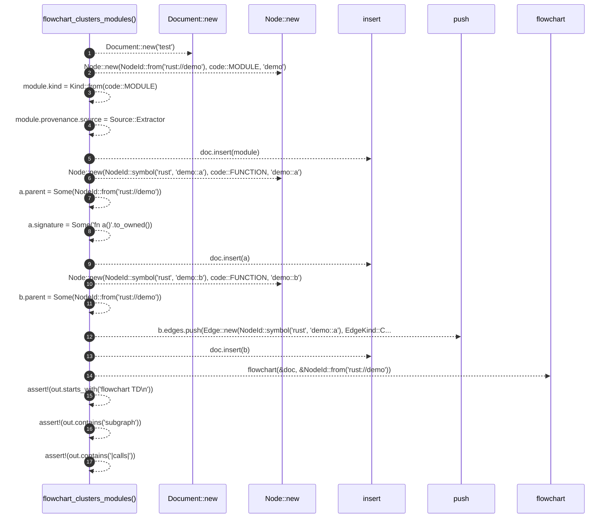

# `robby_render::test_render::flowchart_clusters_modules`

[Self-model](../../README.md) · [test_render](index.md)

| | |
|---|---|
| kind | `code.function` |
| signature | `fn flowchart_clusters_modules()` |
| location | [`crates/robby-render/tests/render.rs:136`](../../../../crates/robby-render/tests/render.rs#L136) |
| provenance | extractor · confidence 1.00 |

```rust
#[test]
fn flowchart_clusters_modules() {
    let mut doc = Document::new("test");

    let mut module = Node::new(NodeId::from("rust://demo"), code::MODULE, "demo");
    module.kind = Kind::from(code::MODULE);
    module.provenance.source = Source::Extractor;
    doc.insert(module);

    let mut a = Node::new(NodeId::symbol("rust", "demo::a"), code::FUNCTION, "demo::a");
    a.parent = Some(NodeId::from("rust://demo"));
    a.signature = Some("fn a()".to_owned());
    doc.insert(a);

    let mut b = Node::new(NodeId::symbol("rust", "demo::b"), code::FUNCTION, "demo::b");
    b.parent = Some(NodeId::from("rust://demo"));
    b.edges.push(Edge::new(NodeId::symbol("rust", "demo::a"), EdgeKind::Calls));
    doc.insert(b);

    let out = flowchart(&doc, &NodeId::from("rust://demo"));

    assert!(out.starts_with("flowchart TD\n"));
    assert!(out.contains("subgraph"));
    assert!(out.contains("|calls|"));
}
```



17 steps · 0 observed · 17 possible only

**Edges**

- calls → [`robby_extract::impl LineIndex::new`](../../robby_extract/index.md)
- calls → [`robby_extract::impl LineIndex::new`](../../robby_extract/index.md)
- calls → [`robby_ir::model::impl Document::insert`](../../robby_ir/model/index.md)
- calls → [`robby_extract::impl LineIndex::new`](../../robby_extract/index.md)
- calls → [`robby_ir::model::impl Document::insert`](../../robby_ir/model/index.md)
- calls → [`robby_extract::impl LineIndex::new`](../../robby_extract/index.md)
- calls → [`robby_ir::model::impl Document::insert`](../../robby_ir/model/index.md)
- calls → [`robby_render::flowchart`](../flowchart.md)

