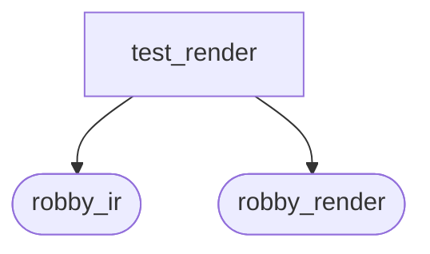
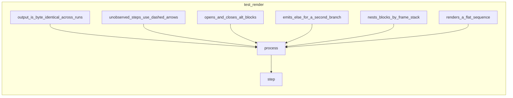

# `robby_render::test_render`

[Self-model](../../README.md) · [robby_render](../index.md)

| | |
|---|---|
| kind | `code.module` |
| provenance | extractor · confidence 1.00 |
| nodes | 18 |

## Package diagram

## Module coupling

## Dependency matrix

| | test_render | robby_ir | robby_render |
|---|---:|---:|---:|
| **test_render** | · | 92 | 58 |
| **robby_ir** | | · | |
| **robby_render** | | | · |
## References

- calls → [`robby_ir::kind`](../../robby_ir/kind/index.md) — from
- calls → [`robby_ir::model`](../../robby_ir/model/index.md) — insert, symbol
- calls → [`robby_ir::process`](../../robby_ir/process/index.md) — participant
- calls → [`robby_ir::run`](../../robby_ir/run/index.md) — get
- calls → [`robby_render`](../index.md) — 6 items
- calls → [`robby_render::markdown`](../markdown/index.md) — report
- calls → [`robby_render::render`](../render/index.md) — comments, externals
- calls → [`robby_render::report`](../report/index.md) — new, push, to_markdown
- calls → [`robby_render::view::deps`](../view/deps/index.md) — from_root
- calls → [`robby_render::view::select`](../view/select/index.md) — collect, markdown

## Referenced by

- calls ← [`robby_extract::rust::impl ProcBuilder<'_, '_>::emit`](../../robby_extract/rust/index.md)
- calls ← [`robby_extract::typescript::push_step`](../../robby_extract/typescript/push-step.md)
- calls ← [`robby_render::markdown::report`](../markdown/report.md)
- calls ← [`robby_render::sequence`](../sequence.md)
- calls ← [`robby_render::test_markdown::fixture`](../test_markdown/fixture.md)
- calls ← [`robby_render::test_web::demo_doc`](../test_web/demo-doc.md)
- calls ← [`robby_render::tree::module_page`](../tree/module-page.md)
- calls ← [`robby_render::tui::timeline`](../tui/timeline.md)
- calls ← [`robby_render::view::execution::from_code_path`](../view/execution/from-code-path.md)
- calls ← [`robby_render::web::impl FrameDetail::from_node_in_doc`](../web/index.md)

## Items

| Item | Kind | Steps | Location |
|---|---|---:|---|
| [`step`](step.md) | `code.function` | 3 | `crates/robby-render/tests/render.rs:13:1` |
| [`process`](process.md) | `code.function` | 6 | `crates/robby-render/tests/render.rs:25:1` |
| [`renders_a_flat_sequence`](renders-a-flat-sequence.md) | `code.function` | 7 | `crates/robby-render/tests/render.rs:35:1` |
| [`unobserved_steps_use_dashed_arrows`](unobserved-steps-use-dashed-arrows.md) | `code.function` | 5 | `crates/robby-render/tests/render.rs:46:1` |
| [`opens_and_closes_alt_blocks`](opens-and-closes-alt-blocks.md) | `code.function` | 12 | `crates/robby-render/tests/render.rs:54:1` |
| [`emits_else_for_a_second_branch`](emits-else-for-a-second-branch.md) | `code.function` | 9 | `crates/robby-render/tests/render.rs:76:1` |
| [`nests_blocks_by_frame_stack`](nests-blocks-by-frame-stack.md) | `code.function` | 9 | `crates/robby-render/tests/render.rs:98:1` |
| [`output_is_byte_identical_across_runs`](output-is-byte-identical-across-runs.md) | `code.function` | 3 | `crates/robby-render/tests/render.rs:122:1` |
| [`stable_ids_are_pinned`](stable-ids-are-pinned.md) | `code.function` | 3 | `crates/robby-render/tests/render.rs:131:1` |
| [`flowchart_clusters_modules`](flowchart-clusters-modules.md) | `code.function` | 25 | `crates/robby-render/tests/render.rs:140:1` |
| [`dependencies_emits_package_weighted_and_dsm`](dependencies-emits-package-weighted-and-dsm.md) | `code.function` | 59 | `crates/robby-render/tests/render.rs:169:1` |
| [`externals_and_comments_sections_render`](externals-and-comments-sections-render.md) | `code.function` | 114 | `crates/robby-render/tests/render.rs:257:1` |
| [`class_diagram_marks_traits_as_interfaces`](class-diagram-marks-traits-as-interfaces.md) | `code.function` | 38 | `crates/robby-render/tests/render.rs:434:1` |

## Imports

- [`use robby_ir::kind::code;`](../../robby_ir/kind/code/index.md)
- [`use robby_ir::{`](../../robby_ir/index.md)
- [`use robby_render::view::{CommentsView, ExternalsView};`](../view/index.md)
- [`use robby_render::{`](../index.md)

