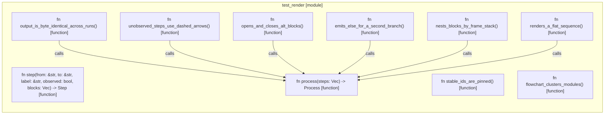

# `robby_render::test_render`

[Self-model](../../README.md) · [robby_render](../index.md)

| | |
|---|---|
| kind | `code.module` |
| provenance | extractor · confidence 1.00 |
| nodes | 14 |

## Items

| Item | Kind | Steps | Location |
|---|---|---:|---|
| [`step`](step.md) | `code.function` | 1 | `crates/robby-render/tests/render.rs:9:1` |
| [`process`](process.md) | `code.function` | 5 | `crates/robby-render/tests/render.rs:21:1` |
| [`renders_a_flat_sequence`](renders-a-flat-sequence.md) | `code.function` | 6 | `crates/robby-render/tests/render.rs:31:1` |
| [`unobserved_steps_use_dashed_arrows`](unobserved-steps-use-dashed-arrows.md) | `code.function` | 4 | `crates/robby-render/tests/render.rs:42:1` |
| [`opens_and_closes_alt_blocks`](opens-and-closes-alt-blocks.md) | `code.function` | 8 | `crates/robby-render/tests/render.rs:50:1` |
| [`emits_else_for_a_second_branch`](emits-else-for-a-second-branch.md) | `code.function` | 6 | `crates/robby-render/tests/render.rs:72:1` |
| [`nests_blocks_by_frame_stack`](nests-blocks-by-frame-stack.md) | `code.function` | 9 | `crates/robby-render/tests/render.rs:94:1` |
| [`output_is_byte_identical_across_runs`](output-is-byte-identical-across-runs.md) | `code.function` | 2 | `crates/robby-render/tests/render.rs:118:1` |
| [`stable_ids_are_pinned`](stable-ids-are-pinned.md) | `code.function` | 3 | `crates/robby-render/tests/render.rs:127:1` |
| [`flowchart_clusters_modules`](flowchart-clusters-modules.md) | `code.function` | 17 | `crates/robby-render/tests/render.rs:136:1` |

## Imports

- `use robby_ir::kind::code;`
- `use robby_ir::{`
- `use robby_render::{flowchart, sequence, stable_id};`

