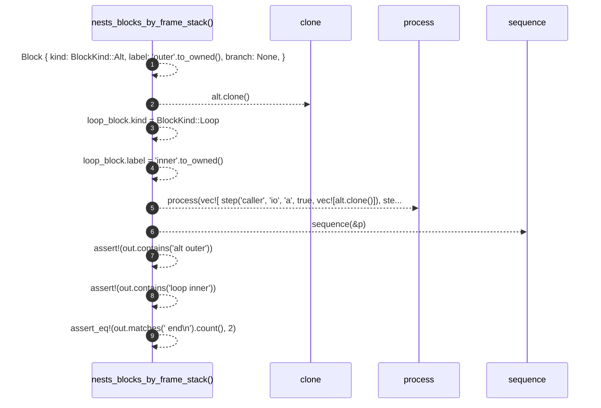

# `robby_render::test_render::nests_blocks_by_frame_stack`

[Self-model](../../README.md) · [test_render](index.md)

| | |
|---|---|
| kind | `code.function` |
| signature | `fn nests_blocks_by_frame_stack()` |
| location | [`crates/robby-render/tests/render.rs:94`](../../../../crates/robby-render/tests/render.rs#L94) |
| provenance | extractor · confidence 1.00 |

```rust
#[test]
fn nests_blocks_by_frame_stack() {
    let alt = Block {
        kind: BlockKind::Alt,
        label: "outer".to_owned(),
        branch: None,
    };
    let mut loop_block = alt.clone();
    loop_block.kind = BlockKind::Loop;
    loop_block.label = "inner".to_owned();

    let p = process(vec![
        step("caller", "io", "a", true, vec![alt.clone()]),
        step("caller", "io", "b", true, vec![alt.clone(), loop_block]),
        step("caller", "io", "c", true, vec![alt]),
        step("caller", "io", "d", true, vec![]),
    ]);
    let out = sequence(&p);

    assert!(out.contains("alt outer"));
    assert!(out.contains("loop inner"));
    assert_eq!(out.matches("    end\n").count(), 2);
}
```



9 steps · 0 observed · 9 possible only

**Edges**

- calls → [`robby_render::test_render::process`](process.md)
- calls → [`robby_render::sequence`](../sequence.md)

