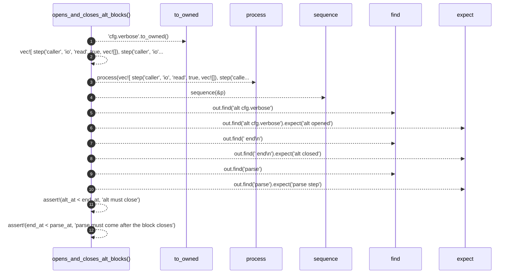

# `robby_render::test_render::opens_and_closes_alt_blocks`

[Self-model](../../README.md) · [test_render](index.md)

| | |
|---|---|
| kind | `code.function` |
| signature | `fn opens_and_closes_alt_blocks()` |
| location | [`crates/robby-render/tests/render.rs:54`](../../../../crates/robby-render/tests/render.rs#L54) |
| provenance | extractor · confidence 1.00 |

```rust
#[test]
fn opens_and_closes_alt_blocks() {
    let alt = Block {
        kind: BlockKind::Alt,
        label: "cfg.verbose".to_owned(),
        branch: None,
    };
    let p = process(vec![
        step("caller", "io", "read", true, vec![]),
        step("caller", "io", "info", true, vec![alt.clone()]),
        step("caller", "io", "parse", true, vec![]),
    ]);
    let out = sequence(&p);

    let alt_at = out.find("alt cfg.verbose").expect("alt opened");
    let end_at = out.find("    end\n").expect("alt closed");
    let parse_at = out.find("parse").expect("parse step");

    assert!(alt_at < end_at, "alt must close");
    assert!(end_at < parse_at, "parse must come after the block closes");
}
```



12 steps · 0 observed · 12 possible only

**Edges**

- calls → [`robby_render::test_render::process`](process.md)
- calls → [`robby_render::sequence`](../sequence.md)

## References

- calls → [`robby_render`](../index.md) — sequence
- calls → [`robby_render::test_render`](index.md) — process

