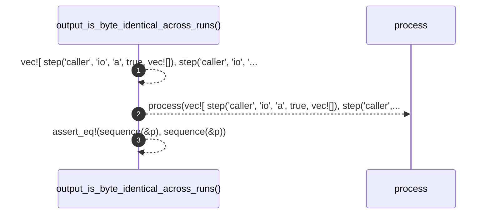

# `robby_render::test_render::output_is_byte_identical_across_runs`

[Self-model](../../README.md) · [test_render](index.md)

| | |
|---|---|
| kind | `code.function` |
| signature | `fn output_is_byte_identical_across_runs()` |
| location | [`crates/robby-render/tests/render.rs:122`](../../../../crates/robby-render/tests/render.rs#L122) |
| provenance | extractor · confidence 1.00 |

```rust
#[test]
fn output_is_byte_identical_across_runs() {
    let p = process(vec![
        step("caller", "io", "a", true, vec![]),
        step("caller", "io", "b", false, vec![]),
    ]);
    assert_eq!(sequence(&p), sequence(&p));
}
```



3 steps · 0 observed · 3 possible only

**Edges**

- calls → [`robby_render::test_render::process`](process.md)

## References

- calls → [`robby_render::test_render`](index.md) — process

