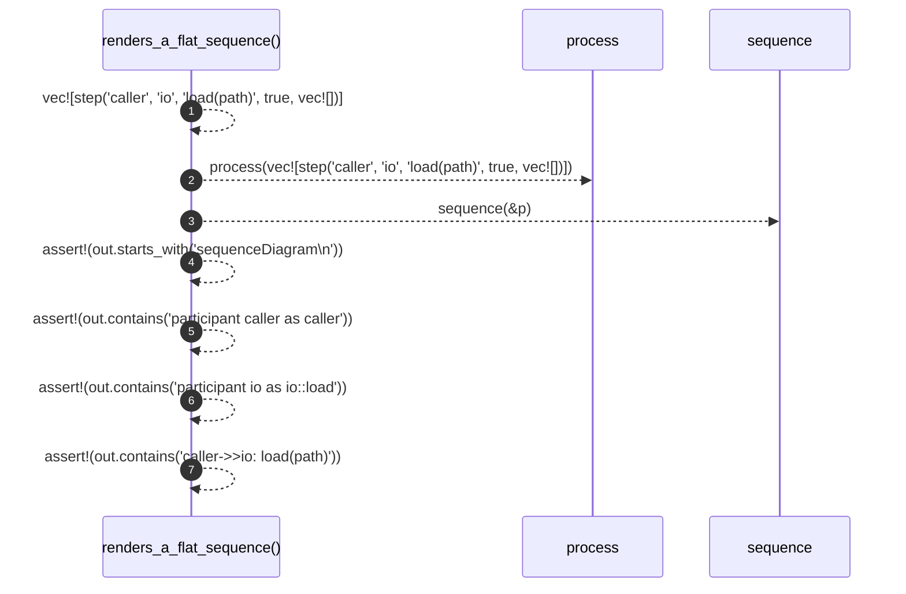

# `robby_render::test_render::renders_a_flat_sequence`

[Self-model](../../README.md) · [test_render](index.md)

| | |
|---|---|
| kind | `code.function` |
| signature | `fn renders_a_flat_sequence()` |
| location | [`crates/robby-render/tests/render.rs:35`](../../../../crates/robby-render/tests/render.rs#L35) |
| provenance | extractor · confidence 1.00 |

```rust
#[test]
fn renders_a_flat_sequence() {
    let p = process(vec![step("caller", "io", "load(path)", true, vec![])]);
    let out = sequence(&p);

    assert!(out.starts_with("sequenceDiagram\n"));
    assert!(out.contains("participant caller as caller"));
    assert!(out.contains("participant io as io::load"));
    assert!(out.contains("caller->>io: load(path)"));
}
```



7 steps · 0 observed · 7 possible only

**Edges**

- calls → [`robby_render::test_render::process`](process.md)
- calls → [`robby_render::sequence`](../sequence.md)

## References

- calls → [`robby_render`](../index.md) — sequence
- calls → [`robby_render::test_render`](index.md) — process

