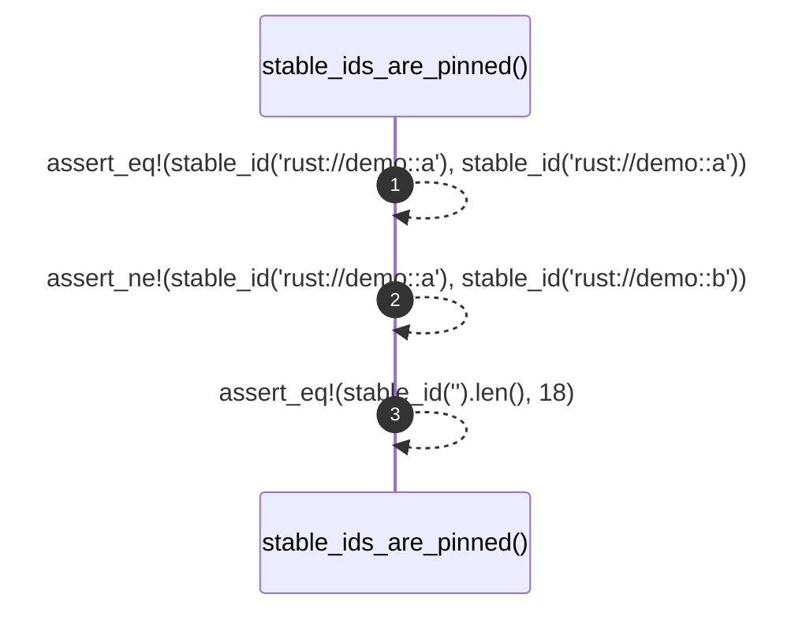

# `robby_render::test_render::stable_ids_are_pinned`

[Self-model](../../README.md) · [test_render](index.md)

| | |
|---|---|
| kind | `code.function` |
| signature | `fn stable_ids_are_pinned()` |
| location | [`crates/robby-render/tests/render.rs:127`](../../../../crates/robby-render/tests/render.rs#L127) |
| provenance | extractor · confidence 1.00 |

```rust
#[test]
fn stable_ids_are_pinned() {
    // If this value changes, every committed diagram in the repo rewrites.
    // Changing it must be a deliberate, documented migration.
    assert_eq!(stable_id("rust://demo::a"), stable_id("rust://demo::a"));
    assert_ne!(stable_id("rust://demo::a"), stable_id("rust://demo::b"));
    assert_eq!(stable_id("").len(), 18);
}
```



3 steps · 0 observed · 3 possible only

