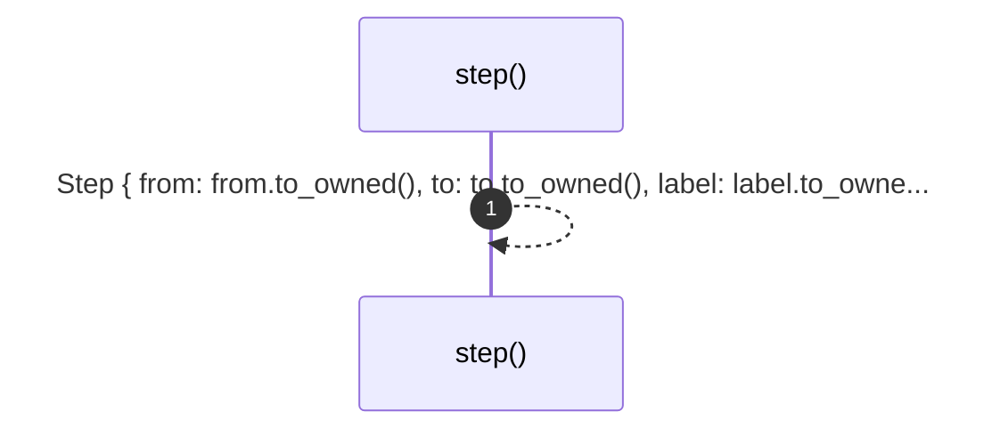

# `robby_render::test_render::step`

[Self-model](../../README.md) · [test_render](index.md)

| | |
|---|---|
| kind | `code.function` |
| signature | `fn step(from: &str, to: &str, label: &str, observed: bool, blocks: Vec<Block>) -> Step` |
| location | [`crates/robby-render/tests/render.rs:9`](../../../../crates/robby-render/tests/render.rs#L9) |
| provenance | extractor · confidence 1.00 |

```rust
fn step(from: &str, to: &str, label: &str, observed: bool, blocks: Vec<Block>) -> Step {
    Step {
        from: from.to_owned(),
        to: to.to_owned(),
        label: label.to_owned(),
        kind: StepKind::Call,
        observed,
        span: None,
        blocks,
    }
}
```



1 steps · 0 observed · 1 possible only

