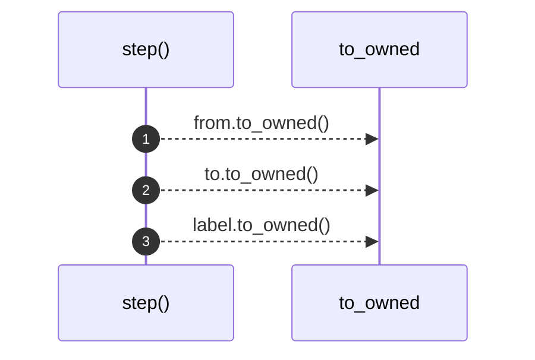

# `robby_render::test_render::step`

[Self-model](../../README.md) · [test_render](index.md)

| | |
|---|---|
| kind | `code.function` |
| signature | `fn step(from: &str, to: &str, label: &str, observed: bool, blocks: Vec<Block>) -> Step` |
| location | [`crates/robby-render/tests/render.rs:13`](../../../../crates/robby-render/tests/render.rs#L13) |
| provenance | extractor · confidence 1.00 |

```rust
fn step(from: &str, to: &str, label: &str, observed: bool, blocks: Vec<Block>) -> Step {
    Step {
        from: from.to_owned(),
        to: to.to_owned(),
        label: label.to_owned(),
        kind: StepKind::Call,
        observed,
        span: None,
        blocks,
    }
}
```



3 steps · 0 observed · 3 possible only

## Referenced by

- calls ← [`robby_extract::rust::impl ProcBuilder<'_, '_>::emit`](../../robby_extract/rust/index.md)
- calls ← [`robby_extract::typescript::push_step`](../../robby_extract/typescript/push-step.md)
- calls ← [`robby_render::test_markdown::fixture`](../test_markdown/fixture.md)
- calls ← [`robby_render::test_render::process`](process.md)
- calls ← [`robby_render::test_web::demo_doc`](../test_web/demo-doc.md)
- calls ← [`robby_render::view::execution::from_code_path`](../view/execution/from-code-path.md)

