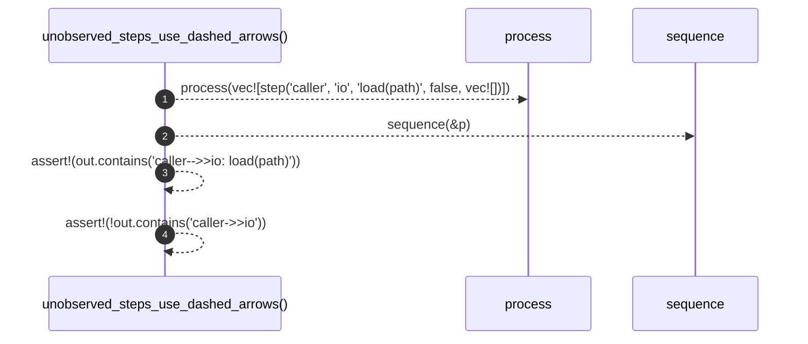

# `robby_render::test_render::unobserved_steps_use_dashed_arrows`

[Self-model](../../README.md) · [test_render](index.md)

| | |
|---|---|
| kind | `code.function` |
| signature | `fn unobserved_steps_use_dashed_arrows()` |
| location | [`crates/robby-render/tests/render.rs:42`](../../../../crates/robby-render/tests/render.rs#L42) |
| provenance | extractor · confidence 1.00 |

```rust
#[test]
fn unobserved_steps_use_dashed_arrows() {
    let p = process(vec![step("caller", "io", "load(path)", false, vec![])]);
    let out = sequence(&p);
    assert!(out.contains("caller-->>io: load(path)"));
    assert!(!out.contains("caller->>io"));
}
```



4 steps · 0 observed · 4 possible only

**Edges**

- calls → [`robby_render::test_render::process`](process.md)
- calls → [`robby_render::sequence`](../sequence.md)

