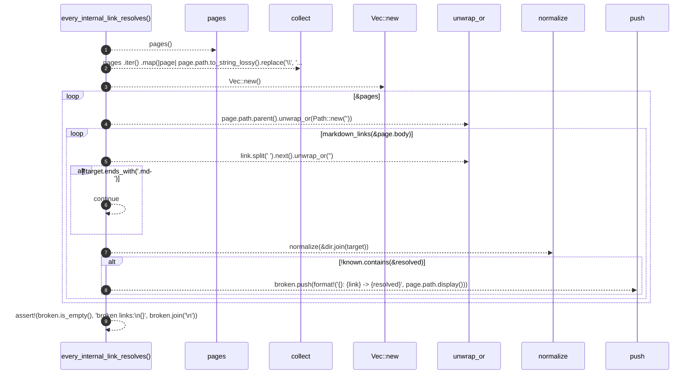

# `robby_render::test_tree::every_internal_link_resolves`

[Self-model](../../README.md) · [test_tree](index.md)

| | |
|---|---|
| kind | `code.function` |
| signature | `fn every_internal_link_resolves()` |
| location | [`crates/robby-render/tests/tree.rs:20`](../../../../crates/robby-render/tests/tree.rs#L20) |
| provenance | extractor · confidence 1.00 |

```rust
#[test]
fn every_internal_link_resolves() {
    let (_, pages) = pages();
    let known: BTreeSet<String> = pages
        .iter()
        .map(|page| page.path.to_string_lossy().replace('\\', "/"))
        .collect();

    let mut broken = Vec::new();
    for page in &pages {
        let dir = page.path.parent().unwrap_or(Path::new(""));
        for link in markdown_links(&page.body) {
            let target = link.split('#').next().unwrap_or("");
            if !target.ends_with(".md") {
                continue;
            }
            let resolved = normalize(&dir.join(target));
            if !known.contains(&resolved) {
                broken.push(format!("{}: {link} -> {resolved}", page.path.display()));
            }
        }
    }

    assert!(broken.is_empty(), "broken links:\n{}", broken.join("\n"));
}
```



9 steps · 0 observed · 9 possible only

**Edges**

- calls → [`robby_render::test_tree::pages`](pages.md)
- calls → [`robby_extract::impl LineIndex::new`](../../robby_extract/index.md)
- calls → [`robby_render::test_tree::normalize`](normalize.md)

