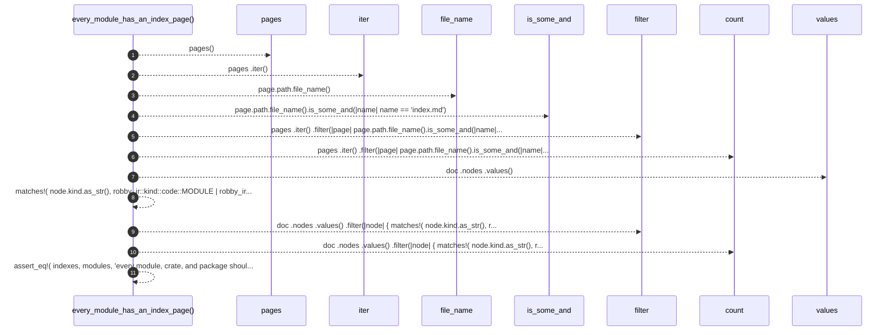

# `robby_render::test_tree::every_module_has_an_index_page`

[Self-model](../../README.md) · [test_tree](index.md)

| | |
|---|---|
| kind | `code.function` |
| signature | `fn every_module_has_an_index_page()` |
| location | [`crates/robby-render/tests/tree.rs:66`](../../../../crates/robby-render/tests/tree.rs#L66) |
| provenance | extractor · confidence 1.00 |

```rust
#[test]
fn every_module_has_an_index_page() {
    let (doc, pages) = pages();
    let indexes = pages
        .iter()
        .filter(|page| page.path.file_name().is_some_and(|name| name == "index.md"))
        .count();

    let modules = doc
        .nodes
        .values()
        .filter(|node| {
            matches!(
                node.kind.as_str(),
                robby_ir::kind::code::MODULE
                    | robby_ir::kind::code::CRATE
                    | robby_ir::kind::code::PACKAGE
            )
        })
        .count();

    assert_eq!(
        indexes, modules,
        "every module, crate, and package should have exactly one index page"
    );
}
```



11 steps · 0 observed · 11 possible only

**Edges**

- calls → [`robby_render::test_tree::pages`](pages.md)

## References

- calls → [`robby_render::test_tree`](index.md) — pages

