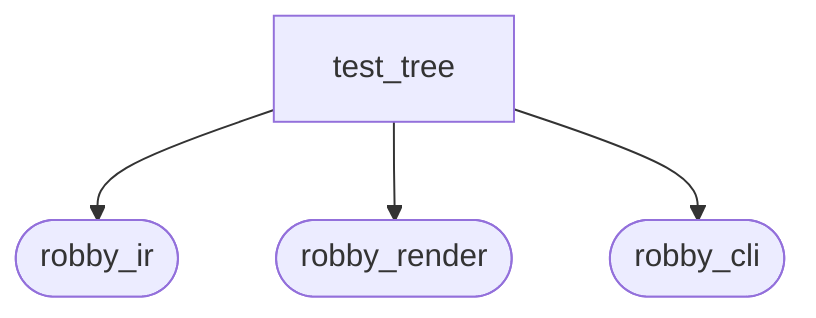
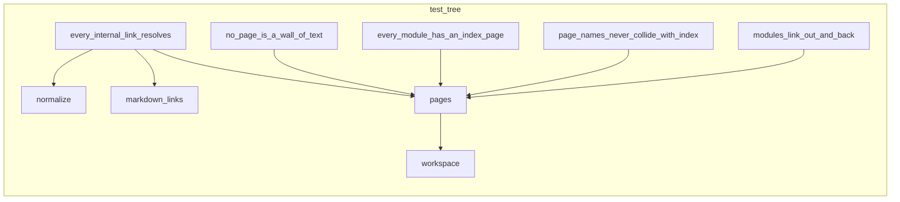

# `robby_render::test_tree`

[Self-model](../../README.md) · [robby_render](../index.md)

| | |
|---|---|
| kind | `code.module` |
| provenance | extractor · confidence 1.00 |
| nodes | 13 |

## Package diagram

## Module coupling

## Dependency matrix

| | test_tree | robby_ir | robby_render | robby_cli |
|---|---:|---:|---:|---:|
| **test_tree** | · | 3 | 13 | 1 |
| **robby_ir** | | · | | |
| **robby_render** | | | · | |
| **robby_cli** | | | | · |
## References

- calls → [`robby_cli`](../../robby_cli/index.md) — extract
- calls → [`robby_ir::kind`](../../robby_ir/kind/index.md) — from
- calls → [`robby_ir::run`](../../robby_ir/run/index.md) — get
- calls → [`robby_render::report`](../report/index.md) — new, push
- calls → [`robby_render::tui`](../tui/index.md) — tree
- calls → [`robby_render::view::scene`](../view/scene/index.md) — contains
- calls → [`robby_render::view::select`](../view/select/index.md) — collect

## Referenced by

- calls ← [`robby_render::workspace_dependencies`](../workspace-dependencies.md)

## Items

| Item | Kind | Steps | Location |
|---|---|---:|---|
| [`workspace`](workspace.md) | `code.function` | 3 | `crates/robby-render/tests/tree.rs:9:1` |
| [`pages`](pages.md) | `code.function` | 4 | `crates/robby-render/tests/tree.rs:13:1` |
| [`every_internal_link_resolves`](every-internal-link-resolves.md) | `code.function` | 24 | `crates/robby-render/tests/tree.rs:20:1` |
| [`no_page_is_a_wall_of_text`](no-page-is-a-wall-of-text.md) | `code.function` | 9 | `crates/robby-render/tests/tree.rs:49:1` |
| [`every_module_has_an_index_page`](every-module-has-an-index-page.md) | `code.function` | 11 | `crates/robby-render/tests/tree.rs:66:1` |
| [`page_names_never_collide_with_index`](page-names-never-collide-with-index.md) | `code.function` | 5 | `crates/robby-render/tests/tree.rs:93:1` |
| [`modules_link_out_and_back`](modules-link-out-and-back.md) | `code.function` | 14 | `crates/robby-render/tests/tree.rs:103:1` |
| [`markdown_links`](markdown-links.md) | `code.function` | 8 | `crates/robby-render/tests/tree.rs:136:1` |
| [`normalize`](normalize.md) | `code.function` | 7 | `crates/robby-render/tests/tree.rs:164:1` |

## Imports

- `use std::collections::BTreeSet;`
- `use std::path::{Component, Path, PathBuf};`
- [`use robby_render::tree;`](../tree/index.md)

