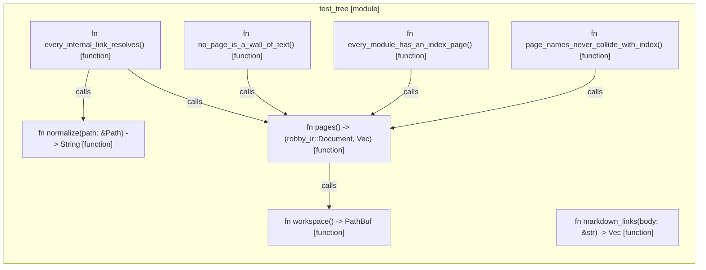

# `robby_render::test_tree`

[Self-model](../../README.md) · [robby_render](../index.md)

| | |
|---|---|
| kind | `code.module` |
| provenance | extractor · confidence 1.00 |
| nodes | 12 |

## Items

| Item | Kind | Steps | Location |
|---|---|---:|---|
| [`workspace`](workspace.md) | `code.function` | 1 | `crates/robby-render/tests/tree.rs:9:1` |
| [`pages`](pages.md) | `code.function` | 4 | `crates/robby-render/tests/tree.rs:13:1` |
| [`every_internal_link_resolves`](every-internal-link-resolves.md) | `code.function` | 9 | `crates/robby-render/tests/tree.rs:20:1` |
| [`no_page_is_a_wall_of_text`](no-page-is-a-wall-of-text.md) | `code.function` | 3 | `crates/robby-render/tests/tree.rs:46:1` |
| [`every_module_has_an_index_page`](every-module-has-an-index-page.md) | `code.function` | 4 | `crates/robby-render/tests/tree.rs:63:1` |
| [`page_names_never_collide_with_index`](page-names-never-collide-with-index.md) | `code.function` | 4 | `crates/robby-render/tests/tree.rs:88:1` |
| [`markdown_links`](markdown-links.md) | `code.function` | 11 | `crates/robby-render/tests/tree.rs:98:1` |
| [`normalize`](normalize.md) | `code.function` | 4 | `crates/robby-render/tests/tree.rs:126:1` |

## Imports

- `use std::collections::BTreeSet;`
- `use std::path::{Component, Path, PathBuf};`
- `use robby_render::tree;`

