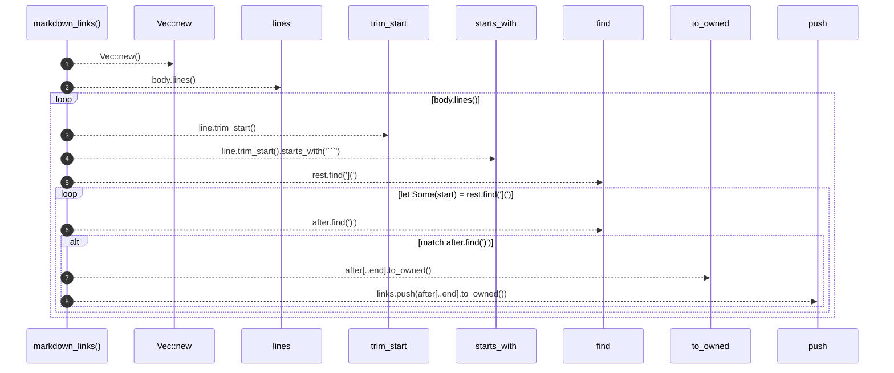

# `robby_render::test_tree::markdown_links`

[Self-model](../../README.md) · [test_tree](index.md)

| | |
|---|---|
| kind | `code.function` |
| signature | `fn markdown_links(body: &str) -> Vec<String>` |
| location | [`crates/robby-render/tests/tree.rs:136`](../../../../crates/robby-render/tests/tree.rs#L136) |
| provenance | extractor · confidence 1.00 |

```rust
fn markdown_links(body: &str) -> Vec<String> {
    let mut links = Vec::new();
    let mut fenced = false;

    for line in body.lines() {
        if line.trim_start().starts_with("```") {
            fenced = !fenced;
            continue;
        }
        if fenced {
            continue;
        }
        let mut rest = line;
        while let Some(start) = rest.find("](") {
            let after = &rest[start + 2..];
            match after.find(')') {
                Some(end) => {
                    links.push(after[..end].to_owned());
                    rest = &after[end + 1..];
                }
                None => break,
            }
        }
    }

    links
}
```



8 steps · 0 observed · 8 possible only

**Edges**

- calls → [`robby_render::report::impl Report::new`](../report/index.md)
- calls → [`robby_render::report::impl Report::push`](../report/index.md)

## References

- calls → [`robby_render::report`](../report/index.md) — new, push

## Referenced by

- calls ← [`robby_render::test_tree::every_internal_link_resolves`](every-internal-link-resolves.md)

