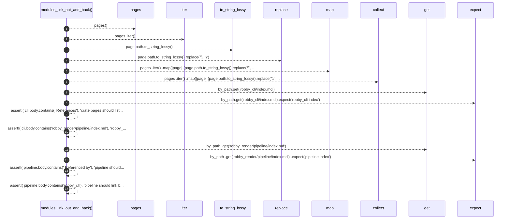

# `robby_render::test_tree::modules_link_out_and_back`

[Self-model](../../README.md) · [test_tree](index.md)

| | |
|---|---|
| kind | `code.function` |
| signature | `fn modules_link_out_and_back()` |
| location | [`crates/robby-render/tests/tree.rs:103`](../../../../crates/robby-render/tests/tree.rs#L103) |
| provenance | extractor · confidence 1.00 |

```rust
#[test]
fn modules_link_out_and_back() {
    let (_, pages) = pages();
    let by_path: std::collections::BTreeMap<_, _> = pages
        .iter()
        .map(|page| (page.path.to_string_lossy().replace('\\', "/"), page))
        .collect();

    let cli = by_path.get("robby_cli/index.md").expect("robby_cli index");
    assert!(
        cli.body.contains("## References"),
        "crate pages should list outbound references"
    );
    assert!(
        cli.body.contains("robby_render/pipeline/index.md"),
        "robby_cli should link to pipeline docs:\n{}",
        cli.body
    );

    let pipeline = by_path
        .get("robby_render/pipeline/index.md")
        .expect("pipeline index");
    assert!(
        pipeline.body.contains("## Referenced by"),
        "pipeline should list backlinks"
    );
    assert!(
        pipeline.body.contains("robby_cli"),
        "pipeline should link back to robby_cli callers:\n{}",
        pipeline.body
    );
}
```



14 steps · 0 observed · 14 possible only

**Edges**

- calls → [`robby_render::test_tree::pages`](pages.md)
- calls → [`robby_render::view::select::collect`](../view/select/collect.md)
- calls → [`robby_ir::model::impl Document::get`](../../robby_ir/model/index.md)
- calls → [`robby_ir::model::impl Document::get`](../../robby_ir/model/index.md)

## References

- calls → [`robby_ir::model`](../../robby_ir/model/index.md) — get
- calls → [`robby_render::test_tree`](index.md) — pages
- calls → [`robby_render::view::select`](../view/select/index.md) — collect

