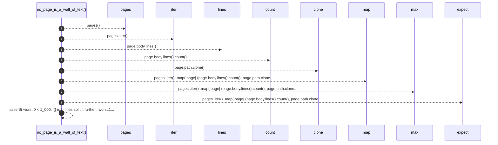

# `robby_render::test_tree::no_page_is_a_wall_of_text`

[Self-model](../../README.md) · [test_tree](index.md)

| | |
|---|---|
| kind | `code.function` |
| signature | `fn no_page_is_a_wall_of_text()` |
| location | [`crates/robby-render/tests/tree.rs:46`](../../../../crates/robby-render/tests/tree.rs#L46) |
| provenance | extractor · confidence 1.00 |

```rust
#[test]
fn no_page_is_a_wall_of_text() {
    let (_, pages) = pages();
    let worst = pages
        .iter()
        .map(|page| (page.body.lines().count(), page.path.clone()))
        .max()
        .expect("pages");

    assert!(
        worst.0 < 1_000,
        "{} is {} lines; split it further",
        worst.1.display(),
        worst.0
    );
}
```



9 steps · 0 observed · 9 possible only

**Edges**

- calls → [`robby_render::test_tree::pages`](pages.md)

## References

- calls → [`robby_render::test_tree`](index.md) — pages

