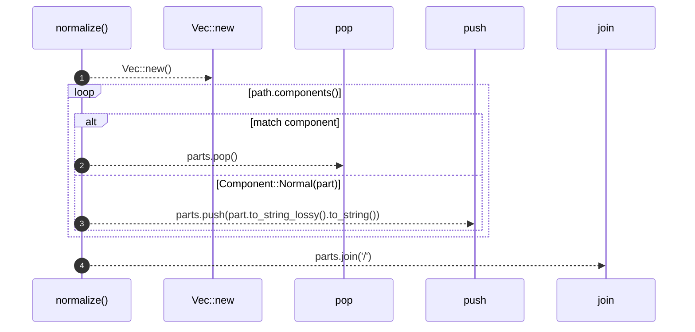

# `robby_render::test_tree::normalize`

[Self-model](../../README.md) · [test_tree](index.md)

| | |
|---|---|
| kind | `code.function` |
| signature | `fn normalize(path: &Path) -> String` |
| location | [`crates/robby-render/tests/tree.rs:126`](../../../../crates/robby-render/tests/tree.rs#L126) |
| provenance | extractor · confidence 1.00 |

```rust
fn normalize(path: &Path) -> String {
    let mut parts: Vec<String> = Vec::new();
    for component in path.components() {
        match component {
            Component::ParentDir => {
                parts.pop();
            }
            Component::CurDir => {}
            Component::Normal(part) => parts.push(part.to_string_lossy().to_string()),
            _ => {}
        }
    }
    parts.join("/")
}
```



4 steps · 0 observed · 4 possible only

**Edges**

- calls → [`robby_extract::impl LineIndex::new`](../../robby_extract/index.md)

